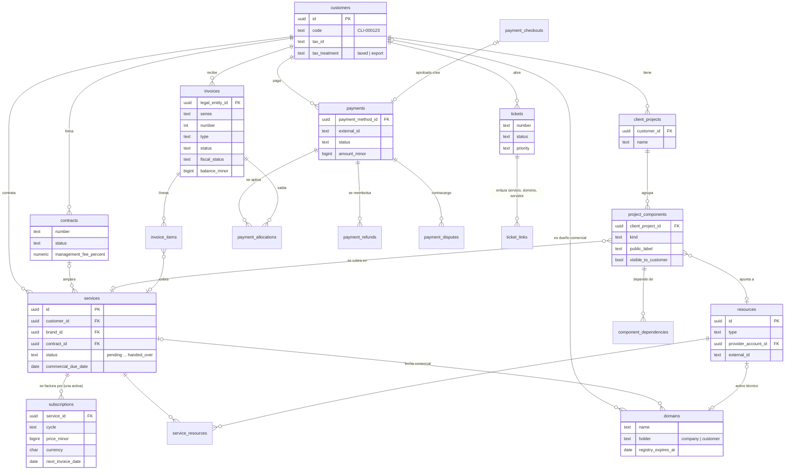

# 02 — Modelo de datos

El modelo gira alrededor del servicio contratado (`services`): cada servicio pertenece a un cliente y a una marca, se factura por una suscripción y se apoya en uno o varios recursos técnicos del proveedor. El esquema completo está en `database/schema.sql` (PostgreSQL 16, 203 tablas: las 194 canónicas del contrato, incluidas las del alcance de docs/00 §25, §26 y §27 —conector web con WordPress, temas del portal, el panel y los correos, administración de paquetes, servicios personalizados, compra en línea, asistente con IA, respaldos ampliados, Libro de Reclamaciones, seguridad administrable, panel de indicadores, historial del editor de textos enriquecido y consultas WHOIS—, más 9 agregadas, listadas en `docs/01-contrato-de-nombres.md`) y se comprueba con `database/verificar_schema.sh`.

## Convenciones que aplica el esquema

| Tema | Regla |
| --- | --- |
| Claves | `id uuid` (UUID v7 generado por la aplicación; `DEFAULT gen_random_uuid()` como respaldo) |
| Columnas comunes | `organization_id`, `created_at`, `updated_at`, `created_by`, `updated_by` en toda tabla de negocio; `version integer` (concurrencia optimista: `PATCH` con versión vieja responde 409) en toda tabla que se actualiza; `deleted_at` donde hay baja lógica; `custom jsonb` donde hay campos personalizados |
| Excepciones | `organizations` (es la raíz) y `permissions` (catálogo global definido por el código) no llevan `organization_id`. Las tablas solo de inserción no llevan `updated_at`, `updated_by` ni `version` porque sus filas nunca cambian; tampoco llevan `version` las tablas técnicas `idempotency_keys`, `code_sequences`, `mfa_recovery_codes`, `email_login_codes`, `password_histories`, `role_permissions`, `user_roles` y `taggables`. `personal_access_tokens` es la tabla estándar de Laravel Sanctum (clave `bigint`) con `organization_id` y `customer_id` agregados |
| Autoría | `created_by` y `updated_by` guardan `users.id` sin clave foránea: también los escriben jobs, conectores y el sistema |
| Dinero | `<campo>_minor bigint` + `currency char(3)` con `CHECK (currency IN ('PEN','USD'))`; los costos de proveedor usan `cost_currency` con cualquier código ISO 4217 |
| Estados | `text` con `CHECK` contra la lista del contrato; las transiciones viven en el código (una clase por entidad) |
| Correlativos legibles | `CLI-000123`, `TKT-…`: tabla `code_sequences` y función `hub_next_code()`; los comprobantes fiscales usan `document_series` |
| Índices | Los índices de búsqueda empiezan por `organization_id`; los únicos con baja lógica son parciales (`WHERE deleted_at IS NULL`) |
| Configuración | Ningún plazo, porcentaje ni texto de aviso queda en el esquema ni en el código: van en `settings` o en tablas de configuración (`dunning_stages`, `sla_targets`, `tld_rules`, `payment_methods`, `notification_templates`) |

## Diagrama entidad-relación del núcleo

## Tablas por módulo

### Identity (IDN)

| Tabla | Para qué sirve | Relaciones clave |
| --- | --- | --- |
| `organizations` | Empresa operadora dueña de los datos; hoy una sola fila, preparada para SaaS | Raíz de todo `organization_id` |
| `users` | Personal y usuarios del portal, con segundo factor por aplicación TOTP o por código al correo, intentos fallidos, bloqueo y zona horaria | N:M `roles` por `user_roles`; 1:1 opcional con `contacts.user_id` |
| `roles` | Roles del sistema (no se borran ni cambian de código o audiencia) y personalizados, creados o copiados de otro | N:M `permissions` por `role_permissions`; `copied_from_role_id` |
| `permissions` | Catálogo global `<modulo>.<entidad>.<accion>` | Lo carga el seeder; la aplicación solo lo lee |
| `role_permissions` | Permisos de cada rol (la matriz por módulo y acción); un rol de cliente solo recibe `portal.*` | `roles`, `permissions` |
| `user_roles` | Roles de cada usuario, con vencimiento para técnicos temporales | `users`, `roles` |
| `user_sessions` | Sesiones y dispositivos, cierre remoto, marca de MFA reciente | `users` |
| `mfa_recovery_codes` | Códigos de recuperación (solo hash) | `users` |
| `email_login_codes` | Códigos de segundo factor enviados al correo (solo hash), con vencimiento, intentos y un solo uso | `users` |
| `trusted_devices` | Dispositivos de confianza que no piden el segundo factor al iniciar sesión dentro del plazo | `users` |
| `password_histories` | Contraseñas anteriores (solo hash) para impedir reutilizarlas | `users` |
| `audit_events` | Auditoría de solo inserción encadenada por hash (`chain_seq`, `prev_hash`, `hash`) | Polimórfica por `entity_type`/`entity_id` |
| `idempotency_keys` | Cabecera `Idempotency-Key`: hash de la petición y respuesta guardada | Única por (`organization_id`, `scope`, `key`) |
| `files` | Archivos en S3 (PDF, XML, CDR, vouchers, contratos) con análisis antivirus | Polimórfica por `attachable_type`/`attachable_id` |
| `tags` | Etiquetas libres | 1:N `taggables` |
| `taggables` | Etiquetas asignadas a cualquier entidad | `tags`; polimórfica |
| `custom_field_definitions` | Definición de campos personalizados por entidad | Valores en la columna `custom` de cada tabla |
| `code_sequences` *(agregada)* | Correlativos legibles por tipo de entidad | Función `hub_next_code()` |
| `personal_access_tokens` *(agregada)* | Tokens bearer de la API pública (Laravel Sanctum) con habilidades acotadas; se exponen como `/admin/api-tokens` | `users` (polimórfica `tokenable`), `customers` |

### Settings (CFG)

| Tabla | Para qué sirve | Relaciones clave |
| --- | --- | --- |
| `settings` | Centro de configuración: un valor por clave y nivel (`global`, `brand`, `product`, `customer`, `contract`); gana el más específico | `scope_id` apunta a la entidad del nivel |
| `setting_changes` | Historial de solo inserción: valor anterior, nuevo, quién y motivo; permite revertir | `settings`; `reverts_change_id` |
| `holidays` | Feriados por país para SLA y cobranza | — |
| `business_hours` | Horario de atención por día de la semana | Lo usa `sla_policies.business_calendar` |

### Brands (BRD)

| Tabla | Para qué sirve | Relaciones clave |
| --- | --- | --- |
| `legal_entities` | Entidad emisora (un solo RUC hoy), inscripción como exportador | 1:N `document_series`, `bank_accounts`, `invoices` |
| `brands` | Las 4 marcas comerciales con dominio del portal, correos y caché del tema publicado (`brand_themes`) | `default_legal_entity_id`; 1:N catálogo, plantillas, servicios |
| `bank_accounts` | Cuentas bancarias, incluida la de detracciones | `legal_entities`, `brands`, `payment_methods` |
| `document_series` | Series de comprobantes y siguiente número | `legal_entities`; función `hub_take_document_number()` |
| `brand_themes` | Tema de una marca (uno por marca) para el portal, el panel y los correos, que apunta a su versión publicada | `brands`; 1:N `brand_theme_versions` |
| `brand_theme_versions` | Tokens de diseño versionados para el portal y el carrito, el panel y los correos; contraste verificado, vista previa, publicación y reversión (la web pública vive en WordPress) | `brand_themes`, `brands`, `files`, `users` |

### Customers (CUS)

| Tabla | Para qué sirve | Relaciones clave |
| --- | --- | --- |
| `customers` | Cliente único, con tratamiento tributario (gravado o exportación), agente de retención y preferencia de consolidación | `origin_brand_id`, `account_manager_id`; 1:N servicios, facturas, tickets |
| `contacts` | Contactos por rol (facturación, administrativo, técnico, autorizado) | `customers`; `user_id` da acceso al portal |
| `communication_consents` | Consentimientos comerciales, aceptación de términos y bajas | `contacts` o `leads` |
| `customer_notes` | Notas internas del cliente | `customers` |

### Sales (SAL)

| Tabla | Para qué sirve | Relaciones clave |
| --- | --- | --- |
| `lead_channels` | Canales de captación administrables | `brands` |
| `lead_forms` | Formularios insertables con clave pública y anti-spam | `lead_channels`, `brands` |
| `pipeline_stages` | Etapas del embudo con resultado (abierto, ganado, perdido) | 1:N `leads` |
| `leads` | Prospectos y oportunidades sobre clientes, con canal, atribución UTM y responsable | `lead_channels`, `pipeline_stages`, `customers` al convertir |
| `lead_stage_changes` | Historial de solo inserción de cada cambio de etapa (también por arrastre en el Kanban) con usuario y origen | `leads`, `pipeline_stages`, `users` |
| `lead_activities` | Seguimientos con fecha y recordatorio | `leads` |
| `assignment_rules` | Asignación automática por marca o canal | `brands`, `lead_channels` |
| `referral_links` | Enlaces de referido (afiliados) con comisión | `customers` |
| `whatsapp_numbers` | Números de WhatsApp Business por marca | `brands` |
| `whatsapp_conversations` | Bandeja compartida; desde aquí se crea prospecto o ticket | `leads`, `customers`, `tickets` |
| `whatsapp_messages` | Mensajes con id externo único | `whatsapp_conversations` |
| `mailing_lists` | Listas sincronizadas con Elastic Email | `brands` |
| `mailing_list_members` | Miembros con estado (suscrito, baja, rebote) | `mailing_lists`, `contacts`, `leads` |
| `quotes` | Cotización con número, estado y versión vigente | `customers` o `leads`; genera `contracts` u `orders` |
| `quote_versions` | Historial de versiones con totales únicos y recurrentes | `quotes` |
| `quote_items` | Líneas únicas o recurrentes | `quote_versions`, `plans` |

### Catalog (CAT)

| Tabla | Para qué sirve | Relaciones clave |
| --- | --- | --- |
| `product_categories` | Árbol del catálogo completo: tipos fijos (hosting compartido y reseller, VPS, dedicados, cloud, dominios, SSL, correo, páginas web, tiendas, Moodle, licencias, soporte, desarrollo a medida) y categorías personalizadas, con su tipo de shortcode | 1:N `products`, `service_types` |
| `products` | Producto con tipo de cobro, aprovisionamiento, "requiere contrato" y elegibilidad para exportación | `brands`; 1:N `plans` |
| `plans` | Ciclo, costo de referencia y límites | `products`; precios en `plan_prices` |
| `plan_prices` | Precio por moneda y vigencia (ajuste masivo con aviso) | `plans` |
| `product_addons` | Complementos de un producto | `products` |
| `bundle_items` | Planes incluidos en un paquete | `plans` |
| `domain_tld_prices` | Costo y precio por extensión, registrador, operación, plazo y moneda, con vigencia y aviso de cambio | `providers`, `domain_extensions` |
| `domain_extensions` | Ficha comercial de la extensión: registrador por defecto, margen mínimo con alerta, venta en línea, orden y destacado | `providers`; 1:N `domain_tld_prices`; reglas en `tld_rules` (DOM) |
| `product_listings` | Ficha de un producto en una marca: nombre por marca, venta en línea, orden, destacado y vigencia en la web | `products`, `brands` |
| `hosting_package_specs` | Ficha técnica de un paquete de hosting: recursos, paquete de WHM y nodo preferido | `products` (1:1), `hosting_nodes` |
| `vps_plan_specs` | Ficha técnica de un plan VPS: CPU, RAM, disco, transferencia, sistemas operativos, administrado, proveedor y plan de origen | `products` (1:1), `providers` |
| `service_types` | Tipo de servicio personalizado creado sin programar: identidad, categoría, marcas, tareas de entrega, contrato, componente del mapa, datos del portal y modo de venta | `product_categories`, `providers`; 1:N `service_type_fields`, `products` |
| `service_type_fields` | Campos propios del tipo (texto, número, lista, fecha, archivo, casilla) | `service_types`; 1:N `service_field_values` |

### Providers (PRV)

| Tabla | Para qué sirve | Relaciones clave |
| --- | --- | --- |
| `providers` | Cualquier proveedor, propio o traído por el cliente, con o sin conector | 1:N `provider_accounts` |
| `provider_accounts` | Cuenta en el proveedor: conector, capacidades, escritura habilitada, costo y renovación | `providers`, `customers` si es del cliente; 1:N `resources` |
| `provider_contacts` | Contactos del proveedor | `providers` |

### Services (SRV)

| Tabla | Para qué sirve | Relaciones clave |
| --- | --- | --- |
| `service_modalities` | Catálogo de modalidades (titular de la cuenta, forma de facturar, qué ve el cliente) | 1:N `services` |
| `services` | Servicio contratado: estado, fecha comercial, renovación, proveedor visible (`show_provider`: nulo hereda el ajuste) | `customers`, `brands`, `products`, `plans`, `contracts` |
| `service_resources` | Enlace N:M entre lo que se cobra y lo que existe en el proveedor | `services`, `resources` |
| `service_field_values` | Valores de los campos propios de un servicio personalizado, coherentes con el tipo del campo | `services`, `service_type_fields`, `files` |
| `subscriptions` | Ciclo, precio y próxima fecha de factura; una sola activa por servicio | `services`; 1:N `invoice_items` |
| `service_status_history` | Cambios de estado con origen y aprobador | `services` |
| `customer_action_flags` | Interruptores de acciones del portal, generales y por cliente | `customers` (NULL = general) |

### ServiceMap (MAP)

| Tabla | Para qué sirve | Relaciones clave |
| --- | --- | --- |
| `client_projects` | Proyecto del cliente ("Web de turismo") | `customers`; 1:N `project_components` |
| `project_components` | Cada pieza: tipo, etiqueta pública, proveedor, cuenta, servicio, ambiente | `client_projects`, `resources`, `provider_accounts`, `services` |
| `component_dependencies` | "El sitio depende del DNS"; base del cálculo de impacto | `project_components` |
| `component_metrics` | Consumo leído por API o manual, marcado público o interno | `project_components` |
| `project_procedures` | Procedimientos por proyecto | `client_projects` |
| `handover_documents` | Ficha de traspaso generada (instantánea y PDF) | `customers`, `client_projects`, `files` |

### Inventory (INV)

| Tabla | Para qué sirve | Relaciones clave |
| --- | --- | --- |
| `resources` | Tabla base de todo activo técnico; nunca se borra al sincronizar (`not_found`) | `provider_accounts`; N:M `services` |
| `hosting_nodes` | Cuenta reseller o VPS propio con WHM, con capacidad y uso | `resources`, `servers` |
| `hosting_accounts` | Cuentas cPanel/Plesk; sin `service_id` son cuentas no registradas | `hosting_nodes`, `services`, `customers` |
| `servers` | Ficha técnica de VPS y dedicados | `resources`; 1:N `server_software` |
| `server_software` | Software instalado y versión | `servers` |
| `maintenances` | Bitácora de mantenimientos técnicos por recurso | `resources`, `tasks` |
| `migration_batches` | Lote de migración entre nodos | `hosting_nodes` origen y destino |
| `migration_items` | Cuenta del lote con su estado propio | `migration_batches`, `hosting_accounts` |
| `resource_dependencies` | Grafo de la CMDB | `resources` |

### Cloud (CLD)

| Tabla | Para qué sirve | Relaciones clave |
| --- | --- | --- |
| `cloud_accounts` | Cuenta AWS/Azure/GCP con titular, modalidad, autorización y periodo de entrega | `provider_accounts`, `customers`, `files` |
| `cloud_projects` | Proyecto o grupo de recursos por ambiente | `cloud_accounts`, `customers` |
| `cloud_resources` | Árbol de recursos descubiertos, etiquetas y costo mensual | `cloud_projects`, `resources` |
| `cloud_budgets` | Presupuesto mensual y gasto real por proyecto | `cloud_projects` |

### Domains (DOM)

| Tabla | Para qué sirve | Relaciones clave |
| --- | --- | --- |
| `domains` | Dominio con titular, fecha real del registrador y bloqueo de transferencia | `provider_accounts`, `customers`, `services`, `resources` |
| `domain_contacts` | Contactos en el registrador por rol | `domains` |
| `domain_operations` | Operaciones del cliente con confirmación por correo y revisión | `domains`, `contacts`, `one_time_links`, `tasks` |
| `tld_rules` | Reglas por extensión; habilitan las operaciones del cliente | — |
| `domain_regularizations` | Paso de titularidad empresa → cliente, un proceso abierto por dominio | `domains`, `tasks` |
| `whois_lookups` | Consultas de disponibilidad, WHOIS público y sugerencias desde `[hub_whois]` y `[hub_buscar_dominio]`: límite por visitante (HMAC de la IP), captcha e indicadores de búsquedas; sin IP ni datos del titular | `brands`, `wp_sites`, `providers` |

### Mail (MAI)

| Tabla | Para qué sirve | Relaciones clave |
| --- | --- | --- |
| `mail_services` | Correo por dominio (cPanel, Workspace, M365), titular y licencias | `domains`, `services`, `hosting_accounts` |
| `mail_dns_checks` | Resultado diario de MX, SPF, DKIM, DMARC | `mail_services` |
| `seat_licenses` | Licencias compradas, asignadas y facturadas por SKU | `mail_services`, `services` |
| `ssl_certificates` | Certificados con dominios cubiertos, emisor, fechas y lugar de instalación | `domains`, `services`, `resources` |

### Saas (SAA)

| Tabla | Para qué sirve | Relaciones clave |
| --- | --- | --- |
| `saas_platforms` | Plataforma compartida y método de reparto de costo | `cloud_projects`, `servers` |
| `saas_instances` | Instancia de cada cliente con plan, uso y límites | `saas_platforms`, `services`, `customers` |

### Contracts (CTR)

| Tabla | Para qué sirve | Relaciones clave |
| --- | --- | --- |
| `contract_templates` | Plantillas por tipo de servicio y marca | `brands`, `product_categories` |
| `contract_clauses` | Biblioteca de cláusulas reutilizables | — |
| `contracts` | Contrato con estado, vigencia, porcentaje de administración y bolsa de horas | `customers`, `quotes`; 1:N `services` |
| `contract_versions` | Original y adendas | `contracts` |
| `contract_comments` | Comentarios internos de redacción | `contracts` |
| `contract_signatures` | Firmas por parte y método | `contracts`, `contract_versions`, `files` |
| `account_handovers` | Entrega de cuenta al cliente con lista de verificación y acta | `services`, `cloud_accounts`, `contracts` |

### Orders (ORD)

| Tabla | Para qué sirve | Relaciones clave |
| --- | --- | --- |
| `orders` | Pedido registrado por ventas; máquina de estados | `customers`, `leads`, `quotes`, `contracts` |
| `order_items` | Líneas del pedido; generan servicios | `orders`, `products`, `services` |
| `provisioning_runs` | Un intento de aprovisionamiento por fila | `orders`, `order_items`, `services` |
| `carts` | Carrito de la compra en línea: marca de origen, cupón, totales y estado (abierto, abandonado, convertido, vencido); anónimo hasta iniciar sesión | `brands`, `wp_sites`, `customers`, `coupons` |
| `cart_items` | Plan y ciclo, o dominio a registrar (con consulta de disponibilidad), transferir o propio | `carts`, `products`, `plans` |
| `checkout_sessions` | Compra confirmada con sesión: total congelado, términos, correo verificado, captcha, revisión manual, pago y el único pedido que genera | `carts`, `customers`, `users`, `contracts`, `payment_methods`, `payments`, `orders` |

### Billing (BIL)

| Tabla | Para qué sirve | Relaciones clave |
| --- | --- | --- |
| `invoices` | Facturas, boletas y notas con estado comercial y fiscal independientes | `legal_entities`, `brands`, `customers`, `document_series`; notas → `references_invoice_id` |
| `invoice_items` | Líneas: servicio, refacturación, comisión por medio de pago, recargo por mora | `invoices`, `services`, `subscriptions`, `tax_rates` |
| `einvoice_submissions` | Envíos al OSE/PSE con XML, CDR y respuesta | `invoices`, `files` |
| `payment_methods` | Medios de pago con comisión y traslado al cliente (`pass_to_customer`) | `bank_accounts` |
| `payments` | Pagos y vouchers, incluida la retención de IGV como pago parcial; el pago con tarjeta nace validado por webhook y pasa a `charged_back` con un contracargo | `customers`, `payment_methods`, `files` |
| `payment_allocations` | Aplicación de pagos a facturas | `payments`, `invoices` |
| `payment_promises` | Compromisos de pago que postergan la suspensión | `invoices`, `customers` |
| `credit_balances` | Movimientos de saldo a favor por moneda | `customers`, `invoices` |
| `coupons` | Cupones y promociones | `brands`, `products` |
| `tax_rates` | IGV y otras tasas con vigencia | `invoice_items` |
| `exchange_rates` | Tipo de cambio diario | Reportes consolidados |
| `provider_bills` | Facturas de proveedor para refacturar | `provider_accounts`, `cloud_accounts`, `contracts`, `invoices` |
| `dunning_sequences` | Secuencia de cobranza por nivel | 1:N `dunning_stages` |
| `dunning_stages` | Momento, acción, canales, destinatario, hora | `dunning_sequences` |
| `dunning_events` | Ejecución de cada etapa por factura | `invoices`, `dunning_stages` |
| `bank_statement_lines` *(agregada)* | Líneas del extracto bancario para la conciliación (`unmatched`, `matched`, `difference`) | `bank_accounts`, `imports`, `payments` |
| `payment_checkouts` *(agregada)* | Intentos de pago con tarjeta desde el portal: una o varias facturas, importe con recargo y sesión del formulario alojado por la pasarela; sin datos de tarjeta | `customers`, `payment_methods`, `payments` |
| `payment_refunds` *(agregada)* | Reembolsos totales o parciales: solicitud, autorización, ejecución por API o manual y nota de crédito | `payments`, `invoices`, `users` |
| `payment_disputes` *(agregada)* | Contracargos con alerta para finanzas, descargos y resultado | `payments`, `customers`, `files`, `alerts` |
| `payment_settlement_lines` *(agregada)* | Líneas de liquidación de la pasarela (bruto, comisión real, neto) para conciliar con pagos y abonos del banco | `payment_methods`, `imports`, `sync_runs`, `payments`, `bank_statement_lines` |

### Finance (FIN)

| Tabla | Para qué sirve | Relaciones clave |
| --- | --- | --- |
| `costs` | Costos por mes (proveedor, licencias, comisiones de pago) | `resources`, `provider_accounts`, `provider_bills`, `payments` |
| `cost_allocations` | Reparto de un costo entre servicios | `costs`, `services`, `saas_instances` |

### Helpdesk (HLP)

| Tabla | Para qué sirve | Relaciones clave |
| --- | --- | --- |
| `sla_policies` | Política general, por producto o por contrato | 1:N `sla_targets` |
| `sla_targets` | Tiempos por prioridad | `sla_policies` |
| `tickets` | Tickets con SLA, pausa en espera y canal de origen | `customers`, `contacts`, `sla_policies`, `whatsapp_conversations` |
| `ticket_messages` | Conversación con el cliente y notas internas (solo del personal) | `tickets` |
| `ticket_links` | Enlace a servicio, dominio, servidor, componente, incidente | `tickets`; polimórfica |
| `kb_categories` | Categorías de la base de conocimientos | 1:N `kb_articles` |
| `kb_articles` | Artículos públicos o internos por idioma de la base de conocimientos del sistema (la ayuda de las webs vive en WordPress) | `kb_categories`, `brands` |
| `satisfaction_surveys` | Encuesta al cerrar el ticket | `tickets` |

### Work (WRK)

| Tabla | Para qué sirve | Relaciones clave |
| --- | --- | --- |
| `work_projects` | Proyectos internos | `customers`, `client_projects` |
| `tasks` | Tareas con origen (ticket, alerta, renovación, conector sin API…) | `work_projects`, `customers`, `services` |
| `task_checklist_items` | Pasos de la tarea | `tasks` |
| `task_dependencies` | Dependencias entre tareas | `tasks` |
| `time_entries` | Horas por técnico, facturables o no | `tasks`, `tickets`, `contracts`, `invoice_items` |
| `change_requests` | Cambios con riesgo y aprobación | `services`, `problems` |
| `problems` | Causa raíz común | 1:N `change_requests`, `incidents` |

### Vault (VLT)

| Tabla | Para qué sirve | Relaciones clave |
| --- | --- | --- |
| `secrets` | Accesos y llaves API cifrados (AES-256-GCM, `key_version`) | Polimórfica por `owner_type`/`owner_id`; `customers` |
| `secret_grants` | Concesiones por usuario o rol, con vencimiento y revocación | `secrets`, `users`, `roles` |
| `secret_access_logs` | Bitácora de solo inserción de revelaciones y usos | `secrets`, `users` |
| `one_time_links` | Enlaces de un solo uso para entregar accesos y códigos | `secrets`, `contacts` |

### Monitoring (MON)

| Tabla | Para qué sirve | Relaciones clave |
| --- | --- | --- |
| `monitors` | Chequeos de disponibilidad, DNS, SSL y reputación | `resources`, `project_components`, `services` |
| `monitor_results` | Resultado de cada chequeo | `monitors` |
| `incidents` | Incidentes técnicos y de seguridad; públicos en el portal de estado | `problems` |
| `incident_affected` | Elementos y clientes afectados | `incidents`, `customers` |
| `maintenance_windows` | Mantenimientos programados visibles al cliente | `resources` |
| `backup_policies` | Frecuencia, retención, RPO, RTO y responsable por recurso | `resources`, `services` |
| `backup_runs` | Ejecuciones de respaldo | `backup_policies` |
| `restore_tests` | Pruebas de restauración | `backup_policies`, `backup_runs`, `tasks` |
| `alerts` | Alertas operativas; una abierta por `dedupe_key` | `customers`, `tasks` |
| `backup_tool_accounts` | Herramienta de respaldos de cada nodo cPanel (por ejemplo JetBackup, por confirmar), con o sin API | `hosting_nodes`, `provider_accounts` |
| `restore_requests` | Solicitud de restauración de sitio, base de datos o buzón a una fecha, con aprobación, ticket, tarea asistida y evidencia | `customers`, `services`, `hosting_accounts`, `backup_runs`, `tickets`, `tasks`, `files` |
| `dr_tests` | Pruebas del plan de recuperación del propio sistema desde AWS S3, con pérdida y tiempo medidos contra los objetivos | `users`, `files`, `tasks` |

### Automation (AUT)

| Tabla | Para qué sirve | Relaciones clave |
| --- | --- | --- |
| `automation_rules` | Evento, condiciones y acciones | 1:N `automation_runs` |
| `automation_runs` | Ejecuciones con resultado | `automation_rules` |
| `notification_templates` | Plantillas por canal, marca, idioma y país, por categoría (aviso, respuesta predefinida, carta de respuesta del Libro, confirmación de formulario) y formato (HTML saneado o texto) | `brands`; usada por `dunning_stages`, `products`, `complaint_responses` |
| `notification_deliveries` | Registro de solo inserción de cada aviso, `dedupe_key` único | `notification_templates`, `customers`, `contacts` |
| `notification_delivery_events` *(agregada)* | Estados de entrega (enviado, entregado, abierto, rebotado) sin modificar el aviso | `notification_deliveries` |
| `webhook_endpoints` | Webhooks entrantes por proveedor y salientes suscritos | `secrets`, `customers` |
| `webhook_events` | Eventos crudos entrantes, solo inserción, id externo único | `webhook_endpoints` |
| `webhook_event_processings` *(agregada)* | Resultado de cada intento de procesar un webhook | `webhook_events` |
| `outbound_webhook_deliveries` | Envíos salientes con reintentos | `webhook_endpoints` |
| `sync_runs` | Una fila por sincronización con conteos y errores | `provider_accounts` |
| `imports` | Asistente de importación CSV con vista previa y reporte de errores | `files` |
| `exports` | Exportaciones en cola con enlace firmado | `files` |
| `rich_text_versions` | Historial de solo inserción de los textos del editor enriquecido (plantillas, cláusulas, artículos, mensajes de formularios, descripciones): HTML saneado, hash, perfil de saneado, autor y versión restaurada | `users`; dueño polimórfico (`owner_type`, `owner_id`) |

### WebConnector (WCN)

| Tabla | Para qué sirve | Relaciones clave |
| --- | --- | --- |
| `wp_sites` | Sitio de WordPress Multisite conectado por marca: URL (única, solo HTTPS), ruta del plugin para el webhook, secreto de firma en la bóveda, orígenes permitidos, página de agradecimiento y última actividad | `brands`, `secrets`; 1:N `wp_site_tokens`, `wp_cache_invalidations` |
| `wp_site_tokens` | Tokens de solo lectura del plugin (solo hash), revocables y con vencimiento | `wp_sites`, `users` |
| `wp_cache_invalidations` | Avisos firmados al plugin cuando cambia lo que muestra, con reintentos | `wp_sites`, `users` |
| `web_forms` | Formularios del constructor: destino prospecto, ticket o correo, responsable, consentimiento, captcha y mensaje | `brands`, `lead_channels`, `users`; 1:N `web_form_fields` |
| `web_form_fields` | Campos del formulario con tipo, obligatoriedad, validaciones y dato de destino | `web_forms` |
| `web_form_submissions` | Envíos recibidos (WordPress no guarda nada) y a qué prospecto, ticket o correo se derivaron | `web_forms`, `brands`, `wp_sites`, `leads`, `tickets` |
| `brand_contact_points` | Teléfonos, correos, WhatsApp, dirección y horario de cada marca | `brands` |
| `legal_documents` | Documentos legales por marca, tipo, idioma y (en términos) tipo de servicio | `brands`, `product_categories`; vigente → `legal_document_versions` |
| `legal_document_versions` | Versiones con fecha, validación de la asesoría legal y una sola vigente | `legal_documents`, `users` |
| `legal_acceptances` | Aceptación de una versión por un usuario (al comprar, al registrarse o en el portal); solo inserción | `legal_document_versions`, `customers`, `users`, `checkout_sessions` |

### Complaints (LRC)

| Tabla | Para qué sirve | Relaciones clave |
| --- | --- | --- |
| `complaints` | Hojas del Libro de Reclamaciones con correlativo por marca, plazo y ticket; solo se eliminan las marcadas como prueba | `brands`, `wp_sites`, `customers`, `services`, `tickets`, `files` |
| `complaint_responses` | Cartas de respuesta enviadas al consumidor, escritas con el editor enriquecido desde una plantilla y con vista previa (hash); no se editan y solo se borran con su hoja de prueba | `complaints`, `notification_templates`, `users`, `files` |
| `complaint_deletions` | Constancia de solo inserción de cada hoja de prueba eliminada (número, motivo, quién y copia) | `brands`, `users` |
| `privacy_requests` | Solicitudes de acceso, rectificación, cancelación u oposición sobre datos personales | `brands`, `customers`, `tickets`, `users`, `files` |

### Assistant (AIA)

| Tabla | Para qué sirve | Relaciones clave |
| --- | --- | --- |
| `ai_assistant_profiles` | Asistente por marca y canal (web o portal): instrucciones, saludo, herramientas, fuentes, derivación a WhatsApp | `brands`, `whatsapp_numbers` |
| `ai_conversations` | Conversación con su consumo y enlace al prospecto, cliente o ticket | `ai_assistant_profiles`, `wp_sites`, `customers`, `users`, `leads`, `tickets`, `whatsapp_conversations` |
| `ai_messages` | Mensajes y llamadas a herramientas; solo inserción | `ai_conversations` |
| `ai_usage` | Consumo mensual por marca para el tope | `brands` |

### Dashboard (DSH)

| Tabla | Para qué sirve | Relaciones clave |
| --- | --- | --- |
| `kpi_definitions` | Catálogo de indicadores (docs/14) sembrado desde `database/seeds/kpis.json`: código, grupo, fórmula, unidad, dirección deseada, frecuencia, dimensiones, meta por defecto y pantalla de detalle | 1:N `kpi_targets`, `kpi_snapshots` |
| `kpi_targets` | Metas por indicador, marca (o todas) y periodo (mes, trimestre o año), en la unidad del indicador o en dinero | `kpi_definitions`, `brands` |
| `kpi_snapshots` | Valores calculados por día o mes y por marca, moneda, categoría y responsable, con numerador y denominador de las razones | `kpi_definitions`, `brands`, `product_categories`, `users` |

## Reglas que el esquema garantiza

Adaptadas de la sección 4 del kit, con el mecanismo que las hace cumplir en la base de datos. Lo que depende de lógica (transiciones de estado, cálculo de saldos, filtro por organización) se cumple en el código y se prueba en la suite de integración.

| Regla del kit | Cómo la garantiza el esquema |
| --- | --- |
| Un dominio guarda dos fechas distintas: la real del registrador y la comercial pactada | `domains.registry_expires_at` y `services.commercial_due_date` son columnas separadas; el dominio enlaza a su servicio con `service_id` |
| Un recurso sin `service_resources` es infraestructura sin cliente; un servicio activo sin suscripción es un servicio sin facturar | `service_resources` es la única vía entre ambos; índice único parcial `subscriptions_one_active_per_service` (una suscripción activa por servicio). `hosting_accounts.service_id NULL`, `domains.customer_id NULL` y `cloud_resources.assigned_customer_id NULL` alimentan la detección |
| `invoices` tiene unicidad en entidad emisora, serie y número; la numeración se asigna con bloqueo de `document_series` | `UNIQUE (organization_id, legal_entity_id, series, number)`; `hub_take_document_number()` incrementa la serie con `UPDATE … RETURNING` (bloqueo de fila hasta el fin de la transacción); `CHECK` impide emitir sin serie, número y fecha |
| Una factura emitida no se edita; se corrige con nota enlazada | `CHECK`: notas de crédito y débito exigen `references_invoice_id`; el bloqueo de edición es regla del código (transición de estado) |
| `payments.external_id` es único por método | `UNIQUE (organization_id, payment_method_id, external_id)` |
| Pago con tarjeta idempotente y sin datos de tarjeta | `payment_checkouts` único por (`organization_id`, `payment_method_id`, `external_session_id`); `CHECK`: un intento `approved` exige pago, transacción externa y fecha; uno `declined` exige motivo. No existe ninguna columna para número, vencimiento ni código de seguridad de tarjeta |
| Reembolsos, contracargos y liquidaciones sin duplicados | `UNIQUE (organization_id, payment_id, external_id)` en `payment_refunds` y `payment_disputes`; `UNIQUE (organization_id, payment_method_id, external_id, transaction_type)` en `payment_settlement_lines`; `CHECK`: un reembolso fuera de `requested` exige quién y cuándo lo autorizó; neto = bruto − comisión |
| Solo finanzas valida un voucher | `CHECK`: un pago `validated`, `refunded` o `charged_back` exige `validated_at` y `validated_by` (salvo origen `webhook`, como el pago con tarjeta); `refunded` exige `refund_authorized_by` |
| Los estados usan enums respaldados por `CHECK` | Cada columna de estado tiene `CHECK` con la lista del contrato |
| Los importes nunca se guardan sin moneda | Cada `_minor` va junto a `currency` (`PEN`/`USD`) o `cost_currency` (ISO 4217); donde el importe es opcional, `CHECK` exige que importe y moneda sean ambos nulos o ambos presentes |
| Exportación sin IGV ni detracción | `CHECK` en `invoices`: `tax_treatment = 'export'` implica `tax_minor = 0` y sin detracción |
| `audit_events` y `secret_access_logs` son solo de inserción | En esas dos y en `setting_changes`, `notification_deliveries`, `webhook_events` (y las dos auxiliares), además de `ai_messages`, `legal_acceptances`, `lead_stage_changes`, `complaint_deletions` y `rich_text_versions`: `REVOKE UPDATE, DELETE, TRUNCATE … FROM hub_app` y trigger `hub_forbid_mutation()` que bloquea también al dueño del esquema |
| Auditoría con encadenamiento por hash | Trigger `hub_audit_chain()`: serializa por organización con un bloqueo de transacción, asigna `chain_seq`, `prev_hash` y `hash = sha256(prev_hash ‖ contenido canónico)`; `hub_audit_verify(org)` devuelve el primer eslabón alterado |
| Webhook repetido se confirma y se descarta | `UNIQUE (organization_id, provider, external_event_id)` en `webhook_events` |
| Notificaciones sin duplicados | `UNIQUE (organization_id, dedupe_key)` en `notification_deliveries`; los estados de entrega van en `notification_delivery_events` |
| Idempotencia de la API | `UNIQUE (organization_id, scope, key)` en `idempotency_keys`; `UNIQUE (organization_id, idempotency_key)` en `orders` y `domain_operations`; `provisioning_runs` único por clave e intento |
| Cuenta cloud del cliente solo con autorización | `CHECK` en `cloud_accounts`: `owner = 'customer'` exige `authorization_file_id` y `customer_id` |
| Ajustes por nivel, gana el más específico | `UNIQUE NULLS NOT DISTINCT (organization_id, key, scope_type, scope_id)`; `CHECK` que `global` no lleve `scope_id` |
| Operaciones de dominio del cliente solo con reglas documentadas | `CHECK` en `tld_rules`: `customer_operations_enabled` exige `rules_documented` |
| Contrato aprobado antes de enviarse y firmado para quedar vigente | `CHECK` en `contracts`: `approved`, `sent` o `signed_active` exigen `approved_at`; `signed_active` exige `signed_at` |
| Una compra en línea genera un solo pedido | `UNIQUE (organization_id, checkout_session_id)` en `orders` y `UNIQUE (organization_id, order_id)` en `checkout_sessions`; un pedido `online` exige su compra; `UNIQUE (organization_id, idempotency_key)` en `checkout_sessions`; índice único parcial `checkout_sessions_one_active_per_cart` (una compra en curso por carrito) |
| Controles del checkout | `terms_accepted_at` y `captcha_verified_at` obligatorios; `CHECK`: no se pasa a pago sin correo verificado; `manual_review` exige motivo; `paid` exige pago y `completed` exige pedido. Un dominio a registrar exige la consulta de disponibilidad. Un intento con tarjeta paga facturas o una compra, nunca ambas |
| El asistente no lee servicios desde la web | `CHECK` en `ai_assistant_profiles`: `customer_services` solo como fuente del canal `portal`; herramientas dentro de la lista permitida; una conversación del portal exige cliente y usuario; `ai_messages` es solo de inserción; `ai_usage` único por marca y mes |
| Un solo tema publicado por marca, siempre con contraste suficiente | `UNIQUE (organization_id, brand_id)` en `brand_themes`; índice único parcial `brand_theme_versions_one_published_uq` (una versión `published` por marca); `CHECK`: una versión `published` exige quién y cuándo la publicó, verificación de contraste y peor relación medida mayor o igual al mínimo copiado de `brands.theme.min_contrast_ratio`; superficies solo `portal`, `admin` y `email` (la web pública vive en WordPress) |
| Catálogo administrable sin duplicados | Ficha única por producto y marca (`product_listings_product_brand_uq`), una ficha técnica por producto (`hosting_package_specs.product_id` y `vps_plan_specs.product_id` únicos), paquete de WHM y plan de origen obligatorios, extensión única por organización; vigencias de `domain_tld_prices` con fin posterior al inicio |
| Restauraciones controladas | `CHECK` en `restore_requests`: confirmación de sobrescritura obligatoria; aprobada o posterior exige aprobador; ejecución exige modo y, si es asistida, tarea; `completed` exige evidencia; índice único parcial `restore_requests_open_uq` (una abierta por objeto). `backup_runs` único por herramienta e id externo |
| Plan de recuperación medible | `CHECK` en `dr_tests`: `passed` exige evidencia, fin de la restauración y pérdida y tiempo medidos dentro de los objetivos copiados de los ajustes |
| Sitios WordPress conectados con token de solo lectura | Índice único `wp_sites_base_url_uq` sobre `lower(base_url)` (en todo el sistema); `CHECK` de URL HTTPS; un sitio `active` exige ruta del plugin y secreto de firma; `wp_site_tokens.token_hash` único, `scope` siempre `read`, revocado exige quién y motivo, y trigger `wp_site_tokens_guard`: un token revocado no se reactiva ni cambia de sitio; avisos de invalidación únicos por sitio y evento |
| Formularios coherentes | `CHECK` en `web_forms`: destino prospecto exige canal, ticket exige tipo y correo exige destinatario; consentimiento obligatorio exige finalidad y texto; activo exige mensaje. Campos con clave y posición únicas, listas y casillas con opciones; envíos únicos por formulario y clave de idempotencia y `routed` exige prospecto, ticket o correo |
| Contacto por marca | Un dato principal por marca y tipo (`brand_contact_points_primary_uq`); teléfonos y WhatsApp en formato E.164 y correo con formato válido |
| Documentos legales con una sola versión vigente | Índice único parcial `legal_document_versions_one_published_uq`; `CHECK`: publicar exige validación de la asesoría legal, fecha de vigencia y quién publicó; un documento por marca, tipo, idioma y tipo de servicio; la política de cookies no existe en el sistema (vive en WordPress) |
| Servicios personalizados coherentes | `CHECK` en `service_types`: activo exige fecha y al menos una marca; componente del mapa dentro de la lista de `project_components.kind`. `service_type_fields`: lista con opciones y trigger `service_type_fields_guard` (el tipo de un campo no cambia). `service_field_values`: clave foránea compuesta a (`id`, `field_type`) del campo y `CHECK` que exige exactamente la columna del tipo; trigger `service_field_values_option` (un valor de lista es una de sus opciones) |
| Catálogo completo por categorías | `CHECK` de `product_categories.kind`; una categoría raíz por tipo fijo (`product_categories_kind_uq`) y tipo de shortcode único; las categorías iniciales no son `custom` |
| Segundo factor y sesiones seguras | `email_login_codes`: un código vigente por usuario y propósito (`email_login_codes_one_open_uq`), intentos acotados y trigger `email_login_codes_guard` (un código usado o invalidado no vuelve a valer ni se usa vencido); `CHECK` en `users`: método de MFA con fecha de activación y TOTP con secreto; `trusted_devices` con vencimiento futuro y token único |
| Roles del sistema protegidos | Trigger `roles_guard`: un rol `is_system` no se borra ni cambia de código, audiencia o marca; trigger `role_permissions_audience`: un rol de cliente solo recibe `portal.*` y uno del personal nunca |
| Historial del Kanban | `lead_stage_changes` solo de inserción; `CHECK`: la etapa cambia de verdad y un arrastre o edición exige el usuario |
| Notas internas solo del personal | `CHECK` en `ticket_messages`: `is_internal` exige autor del personal y canal `internal` |
| Aceptación inmutable | `legal_acceptances` es solo de inserción (REVOKE y trigger); `CHECK`: la aceptación en una compra exige la compra y es única por compra y versión |
| Libro de Reclamaciones íntegro | `UNIQUE (organization_id, brand_id, number)` (correlativo por marca) y código único; `CHECK`: vencimiento posterior al registro, menor de edad con representante, `answered` exige fecha de respuesta; trigger `complaints_guard`: solo se elimina una hoja con `is_test` (con motivo, quién y cuándo), una hoja respondida no se marca como prueba y una de prueba no vuelve a ser real; al eliminarla queda la constancia en `complaint_deletions` (solo inserción); `complaint_responses` no se edita y solo se borra si su hoja es de prueba; una solicitud de datos personales no se responde ni rechaza sin identidad verificada |
| Indicadores coherentes | `kpi_definitions`: código `KPI-<GRP>-NN` cuyo prefijo corresponde al grupo, dimensiones dentro de la lista y moneda obligatoria en indicadores en dinero; el catálogo no se borra desde la aplicación. `kpi_targets`: una meta por indicador, marca, periodo y moneda (`UNIQUE NULLS NOT DISTINCT`), periodo alineado a mes, trimestre o año, y trigger `kpi_targets_guard` que exige dinero con moneda o valor según la unidad (porcentaje 0–100). `kpi_snapshots`: un valor por indicador, periodo y combinación de dimensiones, días y meses bien delimitados |
| Texto enriquecido limpio y trazable | CHECK que rechaza `script`, `iframe`, `object`, `embed`, `style`, `javascript:` y atributos `on…` en plantillas HTML, versiones y cartas del Libro (defensa en profundidad: el saneado con `editor.html.allowed_tags` lo hace la aplicación); WhatsApp solo en texto; hash del HTML verificado en `rich_text_versions` y en `complaint_responses` (se envía lo que se previsualizó, con fecha de vista previa anterior al envío); historial solo de inserción |
| Consultas WHOIS sin datos personales | `whois_lookups` guarda solo el HMAC de la IP, dominio en minúsculas con extensión coherente y resultado de lista cerrada; una consulta frenada por límite o captcha no figura como enviada al registrador; la aplicación no la edita y solo la purga por retención |
| Una sola alerta abierta por causa; un solo compromiso abierto por factura; un solo proceso de regularización abierto por dominio | Índices únicos parciales `alerts_open_dedupe_uq`, `payment_promises_one_open`, `domain_regularizations_open_uq` |

## Cómo se verificó

`database/verificar_schema.sh` crea una base temporal (en un servidor existente o en un PostgreSQL 16 temporal que levanta con `initdb`/`pg_ctl` en `/tmp`), carga `schema.sql` con `ON_ERROR_STOP` y ejecuta las pruebas como el rol de la aplicación `hub_app`, salvo las que comprueban el trigger, que se ejecutan como dueño del esquema. Resultado de la ejecución sobre PostgreSQL 16.15:

| Grupo | Qué se comprobó | Resultado |
| --- | --- | --- |
| Carga | `schema.sql` carga sin errores ni avisos; 203 tablas; todas con `COMMENT ON TABLE`; todas las de negocio con `organization_id` | OK |
| Datos mínimos | Organización, usuario, entidad emisora, marca, serie `F001`, cliente con correlativo `CLI-000001`, producto, plan, precio, servicio activo, suscripción, recurso enlazado; factura en borrador emitida como `F001-1` | OK |
| Numeración | Rechazo de número repetido por `INSERT` y por `UPDATE`, rechazo de factura emitida sin número; 2 sesiones concurrentes × 100 emisiones: 201 facturas, 201 números distintos, sin huecos | OK |
| Solo inserción | `UPDATE`/`DELETE` en `audit_events` como `hub_app` → 42501 (también `ai_messages`, en el grupo del asistente); `UPDATE`/`TRUNCATE` como dueño → bloqueado por trigger; `DELETE` rechazado en `secret_access_logs`, `setting_changes`, `notification_deliveries`, `webhook_events` | OK |
| Cadena de auditoría | `chain_seq` 1,2,3 por organización; `prev_hash` encadena; `hub_audit_verify` informa la cadena íntegra y detecta una manipulación simulada (trigger desactivado por superusuario) en el evento 2 | OK |
| Deduplicación | Pago PayPal repetido, webhook repetido, aviso repetido (`dedupe_key`) y clave de idempotencia repetida → 23505 | OK |
| Pago con tarjeta | Medio `card_gateway`, intento aprobado con pago validado por webhook; webhook de la pasarela repetido y contracargo repetido → 23505; intento aprobado sin pago, reembolso en proceso sin autorización y línea de liquidación con neto incoherente → 23514 | OK |
| Sitios WordPress conectados | Sitio activo con secreto de firma, token de solo lectura y aviso de invalidación entregado; token revocado con motivo; URL repetida en otra organización y aviso repetido → 23505; sitio sin HTTPS, activo sin ruta del plugin, reactivar un token revocado, token revocado sin responsable, token de escritura y aviso fallido sin error → 23514 | OK |
| Compra en línea | Carrito con hosting en venta en línea y dominio consultado; compra pagada por webhook que genera un pedido; segundo pedido de la misma compra y segunda compra en curso del carrito → 23505; pedido en línea sin compra, pago sin correo verificado, dominio sin consulta y tarjeta para facturas y compra a la vez → 23514; compra sin términos → 23502 | OK |
| Asistente con IA | Perfil, conversación en la web y mensajes; perfil web que lee servicios, perfil que lee páginas de un CMS, herramienta no permitida, conversación del portal sin cliente y mensaje de herramienta sin nombre → 23514; `UPDATE` en `ai_messages` → 42501 y `DELETE` como dueño bloqueado por trigger; consumo mensual repetido → 23505 y periodo fuera del primer día → 23514 | OK |
| Apariencia del portal, el panel y los correos | Tema con versión publicada con contraste verificado y borrador nuevo; segundo tema de la misma marca y segunda versión publicada → 23505; publicar sin verificar contraste, con contraste bajo el mínimo, superficie desconocida y superficie de la web pública → 23514 | OK |
| Catálogo de paquetes | Ficha por marca, ficha de hosting con paquete WHM y nodo preferido, plan VPS y extensión `.com` con precios de registro, renovación y transferencia; ficha repetida y extensión repetida → 23505; paquete sin WHM, VPS sin plan de origen y vigencia invertida → 23514 | OK |
| Respaldos ampliados | Herramienta del nodo, respaldo leído y solicitud de restauración con ticket; respaldo con id externo repetido y segunda restauración abierta → 23505; sin confirmación de sobrescritura, aprobada sin aprobador, completada sin evidencia y prueba de recuperación aprobada fuera del RTO → 23514; prueba dentro de objetivos aceptada | OK |
| Formularios, contacto y documentos legales | Formulario activo con destino prospecto, campos y envío derivado; contacto principal de la marca; términos publicados y aceptados en una compra; campo repetido, envío repetido, segundo WhatsApp principal y segunda versión vigente → 23505; formulario sin canal, consentimiento sin texto, lista sin opciones, envío derivado sin destino, teléfono sin formato internacional, versión sin validación legal, documento de cookies y aceptación de compra sin compra → 23514; `UPDATE` de una aceptación → 42501 y `DELETE` como dueño bloqueado por trigger | OK |
| Libro de Reclamaciones | Hoja con correlativo por marca, ticket con plazo y respuesta; correlativo repetido en la marca → 23505; menor sin representante y solicitud de datos respondida sin verificar identidad → 23514; `DELETE` de una hoja real y `UPDATE` de una respuesta como `hub_app` → 42501; hoja marcada como prueba y eliminada con su constancia en `complaint_deletions`; marcar como prueba una hoja respondida o sin motivo → 23514; borrar la respuesta de una hoja real y editar la constancia → 42501 | OK |
| Seguridad administrable | Código al correo usado una vez, dispositivo de confianza, historial de contraseña y MFA por correo; reutilizar o usar vencido un código y más intentos que los permitidos → 23514; dos códigos vigentes del mismo propósito → 23505; TOTP sin secreto y dispositivo vencido → 23514 | OK |
| Roles y matriz de permisos | Rol del sistema, rol personalizado copiado de él con un permiso; borrar un rol del sistema, cambiarle el código y volver de sistema uno personalizado → 42501; permiso del portal en un rol del personal → 23514; borrar un rol personalizado | OK |
| Servicios personalizados | Categoría fija de páginas web, tipo activo con campos número, lista y fecha, producto y servicio con valores coherentes; texto en un campo de fecha, valor de lista fuera de las opciones, cambio de tipo de un campo, categoría con tipo desconocido, tipo activo sin marcas y componente desconocido → 23514; valor con tipo distinto al del campo → 23503; segunda categoría raíz del mismo tipo → 23505 | OK |
| Panel de indicadores | Catálogo con un indicador en dinero y uno en porcentaje, metas y valores calculados; prefijo de código distinto del grupo, dinero sin dimensión moneda, dimensión fuera de lista, código mal formado, meta en porcentaje mayor que 100, meta en dinero sin importe, meta trimestral desalineada y valor mensual con fin incorrecto → 23514; meta y valor repetidos (también con dimensiones nulas) → 23505; borrar un indicador como `hub_app` → 42501 | OK |
| Editor de textos enriquecido | Plantilla de carta del Libro en HTML, respuesta predefinida por WhatsApp en texto y dos versiones del historial; script incrustado, WhatsApp en HTML, carta del Libro por otro canal, atributo `onerror` y hash que no corresponde → 23514; versión repetida → 23505; `UPDATE` del historial → 42501 y `DELETE` como dueño bloqueado por trigger | OK |
| Libro: hoja pública y respuesta | Hoja con enlace a su constancia y respuesta desde plantilla con vista previa; HTML distinto del previsualizado, envío antes de la vista previa y enlace `javascript:` → 23514; dos hojas con el mismo enlace → 23505 | OK |
| Consultas WHOIS y servidores | Consultas disponible, registrada y frenada por captcha; conteo por visitante con `hub_whois_recent_count()`; dominio inválido, extensión que no corresponde, consulta frenada enviada al registrador y disco fuera de lista → 23514; `UPDATE` de una consulta → 42501; purga por retención y servidor dedicado con ubicación aceptados | OK |
| CRM y soporte | Cambio de etapa por arrastre registrado; arrastre sin usuario y cambio a la misma etapa → 23514; `UPDATE` del historial → 42501; nota interna escrita como cliente → 23514 y nota del personal aceptada | OK |
| Reglas de negocio | Moneda `EUR` rechazada; estado fuera del contrato rechazado; segunda suscripción activa rechazada; nota de crédito sin referencia rechazada; exportación con IGV rechazada; cuenta cloud del cliente sin autorización rechazada; ajuste global duplicado rechazado y sobrescritura por cliente aceptada; consultas de detección de servicios sin facturar y recursos sin cliente | OK |

Resumen de la ejecución: **193 pruebas OK, 0 fallidas, 203 tablas.**

## Añadidos y precisiones frente al contrato y al kit

| Elemento | Motivo |
| --- | --- |
| `code_sequences` (IDN) y función `hub_next_code()` | El kit pide correlativos legibles por tipo (`CLI-000123`); `document_series` es solo para comprobantes fiscales |
| `notification_delivery_events` (AUT) | `notification_deliveries` es solo de inserción, pero el kit pide estado de entrega y apertura: los cambios de estado se guardan como eventos nuevos |
| `webhook_event_processings` (AUT) | Igual que el anterior para el resultado del procesamiento en cola de `webhook_events` |
| `bank_statement_lines` (BIL) | Conciliación bancaria (pantalla P-BIL-09): cada línea del extracto importado se empareja con un pago |
| `payment_checkouts`, `payment_refunds`, `payment_disputes`, `payment_settlement_lines` (BIL) | Pago con tarjeta mediante pasarela local (docs/00 §21): intento con formulario alojado, reembolso total o parcial por API, contracargos (P-BIL-16) y conciliación con el reporte de liquidación (P-BIL-17) |
| Alcance de docs/00 §25 | Tablas canónicas nuevas de BRD (`brand_themes`, `brand_theme_versions`), WCN (`legal_documents`, `legal_document_versions`, `legal_acceptances`), CAT (`domain_extensions`, `product_listings`, `hosting_package_specs`, `vps_plan_specs`), AIA, ORD (`carts`, `cart_items`, `checkout_sessions`) y MON (`backup_tool_accounts`, `restore_requests`, `dr_tests`); columnas `products.sellable_online`, `orders.channel`, `orders.checkout_session_id`, `payments.checkout_session_id`, `payment_checkouts.checkout_session_id`, `backup_runs.backup_tool_account_id`, `backup_runs.external_id`, `domain_tld_prices.domain_extension_id`, `domain_tld_prices.customers_notified_at`; el módulo LRC (`complaints`, `complaint_responses`, `privacy_requests`); valores nuevos `assistant` en `lead_channels.kind` y `tickets.channel`, `web_form` en `tickets.channel`, `checkout` en `communication_consents.source` y `restore_request` en `tasks.source_type`. `payment_checkouts.invoice_ids` deja de exigir al menos una factura cuando el intento paga una compra en línea (exactamente una de las dos cosas) |
| Alcance de docs/00 §26 | El sistema deja de tener CMS: se eliminaron las 19 tablas de páginas, bloques, versiones, menús, novedades, redirecciones, URLs 404, medios, CSS propio, Search Console, fuentes y caché de WordPress, cookies y scripts, y las columnas kb_articles.source, kb_articles.wp_post_cache_id y product_listings.seo. Tablas nuevas: WCN (`wp_sites`, `wp_site_tokens`, `wp_cache_invalidations`, `web_forms`, `web_form_fields`, `web_form_submissions`, `brand_contact_points`), CAT y SRV (`service_types`, `service_type_fields`, `service_field_values`), IDN (`email_login_codes`, `trusted_devices`, `password_histories`), SAL (`lead_stage_changes`) y LRC (`complaint_deletions`); columnas `product_categories.kind`, `shortcode_type`, `is_system`, `products.service_type_id`, `users.mfa_method`, `failed_login_count`, `locked_until`, `must_change_password`, `roles.copied_from_role_id`, `complaints.is_test`, `test_marked_at`, `test_marked_by`, `test_reason` y `wp_site_id` en `carts`, `ai_conversations` y `complaints`; valores `wp_site` en `secrets.owner_type` y `brand_info` en `ai_assistant_profiles.knowledge_sources` |
| Alcance de docs/00 §27 | Tablas canónicas nuevas de DSH (`kpi_definitions`, `kpi_targets`, `kpi_snapshots`), AUT (`rich_text_versions`, solo inserción) y DOM (`whois_lookups`, sin `UPDATE` para la aplicación); columnas `notification_templates.category`, `notification_templates.content_format`, `complaint_responses.body_html`, `complaint_responses.template_id`, `complaint_responses.previewed_at`, `complaint_responses.preview_sha256`, `complaints.sheet_token_hash`, `vps_plan_specs.location`, `vps_plan_specs.cpu_model`, `vps_plan_specs.disk_type`; valor `kpi_values` en `exports.report`; función `hub_whois_recent_count()`; CHECK de defensa contra HTML peligroso en plantillas, versiones y cartas (el saneado lo hace la aplicación) |
| `personal_access_tokens` (IDN) | Tabla estándar de Laravel Sanctum para los tokens de la API pública (docs/00, secciones 2 y 13) |
| Columna `version` | Concurrencia optimista del kit (§9): toda tabla que se actualiza la lleva. Por eso las columnas de versión de negocio se llaman `quote_versions.version_number`, `contract_versions.version_number`, `saas_instances.app_version` y `server_software.installed_version` |
| Columnas pedidas por los módulos | Las columnas que citan `docs/modulos` existen en el esquema (por ejemplo `hosting_nodes.capacity_thresholds`, `accepts_new_accounts`, `cpanel_license_tier`; `tasks.requires_approval`, `approved_by`, `recurrence`; `change_requests.kind`, `target_type`, `target_id`; `tickets.department`, `category`, `level`; `payment_methods.pass_to_customer`). `tools/verificar_coherencia.py` lo comprueba |
| `plan_prices` lleva el precio de venta | La tabla de §4 pone `price_minor` en `plans`; aquí el precio vive solo en `plan_prices` (por moneda y vigencia) para permitir el ajuste masivo con aviso sin duplicar datos |
| Nombres del contrato sobre los de §4 | `reseller_accounts` → `hosting_nodes`; `opportunities` → `leads` con `customer_id`; `projects` → `work_projects`; `task_checklists` → `task_checklist_items`; `dns_checks` (JSONB) → `mail_dns_checks`; `service_orders` no se crea porque lo cubren `orders` |
| Estado de pago "en validación" | El contrato fija `reported, validated, rejected, refunded`; el voucher permanece `reported` hasta que finanzas lo valida. Se agrega `charged_back` para el contracargo de un pago con tarjeta |
| Estados no fijados por el contrato | Toda columna de estado o tipo tiene su lista en un `CHECK` del esquema; esas listas son la fuente y están copiadas en `docs/01-contrato-de-nombres.md`. El OpenAPI usa los mismos valores |
