# 03 — Máquinas de estado

Este documento fija los estados y las transiciones permitidas de cada entidad con ciclo de vida. Los nombres de estados, tablas y permisos salen de `docs/01-contrato-de-nombres.md`. Las reglas que se citan como `RN-...` están en `04-reglas-de-negocio.md` y los ajustes como `billing....`, `services....`, etc., en `database/seeds/settings.json` (explicados en `09-centro-de-configuracion.md`).

## Cómo se implementan

- Cada entidad tiene un enum de PHP respaldado (`ServiceStatus`, `InvoiceStatus`, ...) con `CHECK` en la base, y una clase de transiciones por entidad (`<Entidad>Transitions`) que es la única forma de cambiar el estado (docs/00 §4, §10).
- Toda transición: (1) valida el permiso del actor o que el actor sea el sistema, (2) valida las precondiciones de la tabla, (3) cambia el estado dentro de una transacción con bloqueo de la fila, (4) escribe `audit_events`, (5) emite el evento de dominio **después del commit**. Los efectos los ejecutan oyentes en cola; los controladores no llaman a otros módulos (docs/00 §2).
- Una transición no listada en la tabla de su entidad responde `409` con `code = invalid_transition` (RFC 9457).
- "Sistema" significa un job programado, un oyente de evento o un webhook entrante; su actor en auditoría es `system` con el nombre del job.
- Los pasos "revisión humana", "validación de pago" y "autorización" son estados reales o tareas en estado real, nunca solo avisos (docs/00 §10). Cuando la aprobación no tiene estado propio en la entidad, se modela como una tarea en `tasks` (`source_type` = entidad, estado `in_review`) que solo puede cerrar quien tiene el permiso indicado.
- Todo plazo citado (días, horas, porcentajes) se lee del centro de configuración con herencia; ninguno está escrito en el código (RN-CFG-001).

Índice de máquinas (31 diagramas en 30 entidades): services · subscriptions · invoices.status · invoices.fiscal_status · payments · payment_promises · orders · tickets · tasks · leads · quotes · contracts · domain_operations · migration_items · incidents · account_handovers · payment_checkouts · payment_refunds · payment_disputes · wp_sites · web_forms · carts · checkout_sessions · restore_requests · ai_conversations · brand_theme_versions · service_types · legal_document_versions · complaints · privacy_requests · web_form_submissions (las de carritos, compras, restauraciones, asistente, temas, documentos legales, reclamos y datos personales vienen de docs/00 §25; las de sitios WordPress, formularios, tipos de servicio y envíos, de docs/00 §26, y reemplazan a las del antiguo CMS). Al final, los flujos de negocio A a T.

---

## 1. `services.status`

Estados: `pending`, `active`, `suspended`, `terminated`, `cancelled`, `handed_over`. Finales: `terminated`, `cancelled`, `handed_over`.

- `terminated`: baja definitiva con respaldo previo y aprobación del administrador (por mora o por solicitud del cliente).
- `cancelled`: el servicio no llega a activarse o termina sin baja forzada (por ejemplo, un dominio que no se renovó al vencer su fecha real).
- `handed_over`: entregado al cliente (fin del periodo de una cuenta cloud administrada, transferencia de dominio completada). Se conserva el historial (docs/00 §20).

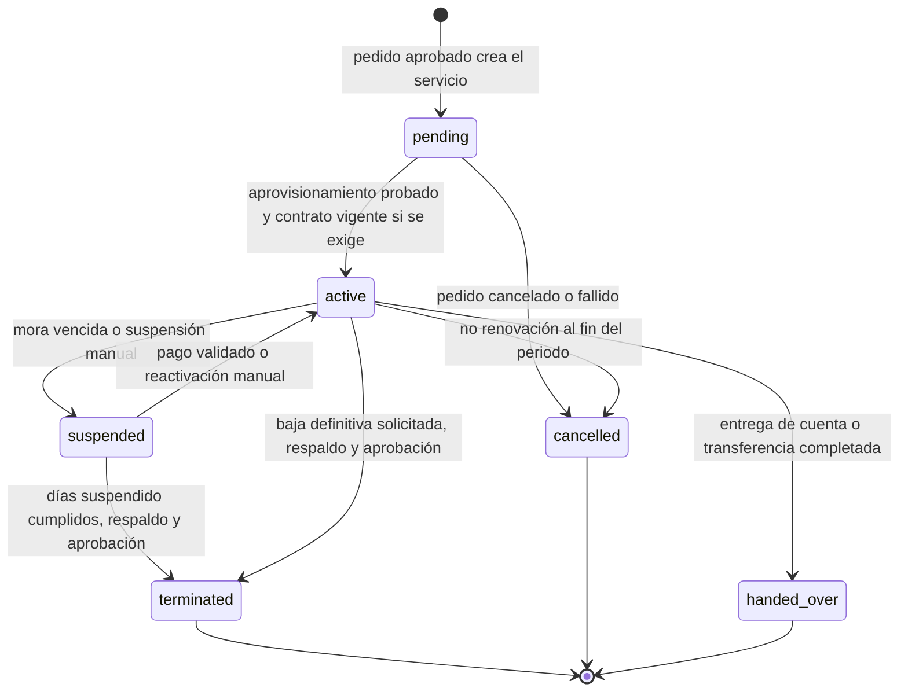

| Desde | Hacia | Disparador | Quién (rol/permiso o sistema) | Validaciones | Evento emitido | Efectos |
|---|---|---|---|---|---|---|
| — | pending | Oyente de `OrderApproved` crea un servicio por cada `order_items` | Sistema | Plan vigente en `plans`; cliente activo; marca del pedido | `ServiceCreated` | Fila en `service_status_history`; enlace a pedido |
| pending | active | Oyente de `OrderActivated` (pedido en `testing` aprobado) o alta manual asistida | Sistema; o `support` con `services.service.update` | Si el producto es "requiere contrato": contrato en `signed_active` que lo cubre (RN-SRV-002, RN-CTR-004). Si el producto es recurrente: se crea la suscripción en la misma transacción (RN-SRV-001). Recursos enlazados en `service_resources` | `ServiceActivated` | Suscripción `active`; `activated_at`; `commercial_due_date`; componente en el mapa (RN-MAP-009); correo de bienvenida con accesos por `one_time_links` (RN-SRV-013) |
| pending | cancelled | Oyente de `OrderCancelled` u `OrderFailed` cancelado | Sistema | Sin facturas pagadas pendientes de devolver (si las hay, finanzas resuelve reembolso o saldo a favor) | `ServiceCancelled` | Recursos creados se marcan para baja con tarea en `tasks` |
| active | suspended | Job `SuspendOverdueServices` | Sistema | Factura del servicio en `overdue` con `services.suspension.days_after_due` cumplidos; el servicio no es de dominio (RN-SRV-004); no exento (`services.suspension.exempt`); sin `payment_promises` en `open` con fecha vigente (RN-BIL-038); si el día no es hábil y la etapa lo indica, pasa al siguiente día hábil (RN-BIL-033) | `ServiceSuspended` | Conector `suspend()` si `capabilities()` lo admite; si no, tarea manual (RN-SRV-005). Suscripción a `paused`. Aviso al cliente y a finanzas (copia interna de la etapa) |
| active | suspended | Suspensión manual | `admin` con `services.service.suspend` | Motivo obligatorio; mismo bloqueo para dominios | `ServiceSuspended` | Igual que la anterior |
| suspended | active | Oyente de `PaymentValidated`/`InvoicePaid` | Sistema | `services.reactivation.auto_on_payment = true`; las facturas vencidas que motivaron la suspensión están en `paid`. Un pago `reported` nunca reactiva (RN-BIL-050) | `ServiceReactivated` | Conector `unsuspend()` o tarea manual; suscripción a `active`; aviso de reactivación |
| suspended | active | Reactivación manual | `admin` con `services.service.suspend` | Motivo obligatorio | `ServiceReactivated` | Igual que la anterior |
| suspended | terminated | Job diario detecta `services.termination.days_after_suspension` cumplidos y crea tarea de aprobación; el administrador ejecuta la baja | Sistema propone; `admin` con `services.service.terminate` ejecuta | Tarea de aprobación en `in_review`; último `backup_runs` del recurso exitoso y posterior a la suspensión (RN-SRV-008); MFA no exigido por el kit; nunca automático | `ServiceTerminated` | Conector de baja o tarea manual; suscripción `cancelled`; recursos liberados; componentes del mapa marcados como dados de baja; ficha de traspaso disponible |
| active | terminated | Baja definitiva solicitada por el cliente (flujo H) | `admin` con `services.service.terminate` | Respaldo previo exitoso; ticket de solicitud enlazado; deudas revisadas por finanzas | `ServiceTerminated` | Igual que la anterior |
| active | cancelled | Fin de periodo sin renovación: dominio con `registry_expires_at` vencida sin pago, o no renovación acordada | Sistema (dominios, al sincronizar); `admin`/`sales` con `services.service.update` | Para dominios: la factura de renovación no está pagada y la fecha real ya pasó | `ServiceCancelled` | Suscripción `cancelled`; el dominio queda marcado como no renovado |
| active | handed_over | Oyente de `AccountHandoverCompleted` o de `DomainOperationCompleted` con `type = transfer_out` | Sistema | Entrega en `completed` con acta firmada (RN-CTR-008); o transferencia de salida confirmada | `ServiceHandedOver` | Suscripción `cancelled` (termina la facturación) salvo acuerdo de continuar como administración, que crea un servicio nuevo con modalidad `managed_customer_account` (RN-SRV-011) |

---

## 2. `subscriptions.status`

Estados: `active`, `paused`, `cancelled`. Final: `cancelled`.

> Decisión de diseño a confirmar (el kit no la fija): mientras el servicio está suspendido la suscripción queda `paused` y el job de generación no crea nuevas facturas para ella; la deuda ya emitida sigue su curso. Al reactivar vuelve a `active` con la misma `next_invoice_date`.

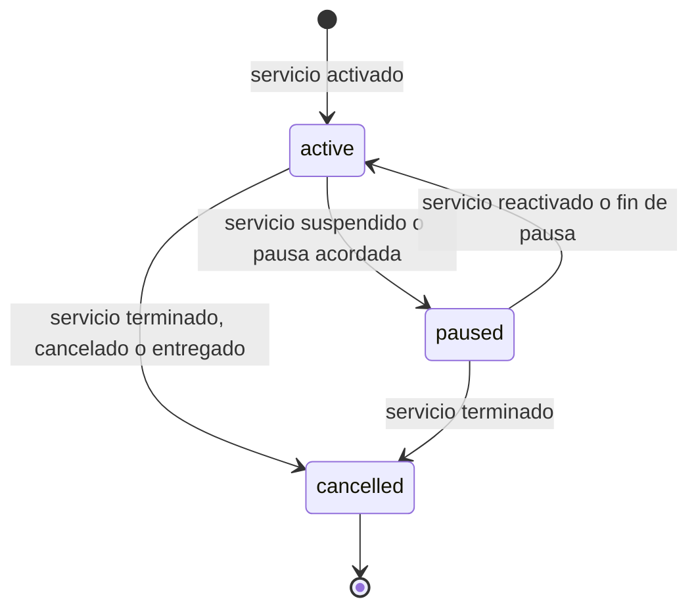

| Desde | Hacia | Disparador | Quién | Validaciones | Evento emitido | Efectos |
|---|---|---|---|---|---|---|
| — | active | Oyente de `ServiceActivated` (producto recurrente) | Sistema | Precio y ciclo del plan; moneda PEN/USD | `SubscriptionStarted` | `next_invoice_date` calculada |
| active | paused | Oyente de `ServiceSuspended`; o pausa acordada | Sistema; `finance` con `services.subscription.update` | Motivo en pausa manual | `SubscriptionPaused` | `GenerateRenewalInvoices` la omite |
| paused | active | Oyente de `ServiceReactivated`; o fin de pausa | Sistema; `finance` con `services.subscription.update` | Servicio en `active` | `SubscriptionResumed` | Vuelve a la generación |
| active / paused | cancelled | Oyente de `ServiceTerminated`, `ServiceCancelled`, `ServiceHandedOver` | Sistema | — | `SubscriptionCancelled` | No se generan más facturas |

---

## 3. `invoices.status`

Estados: `draft`, `issued`, `partially_paid`, `paid`, `overdue`, `void`. Finales: `paid` (solo se reabre por contracargo), `void`. Aplica a los cuatro `invoices.type` (factura, boleta, nota de crédito, nota de débito). El estado fiscal es una máquina aparte (sección 4).

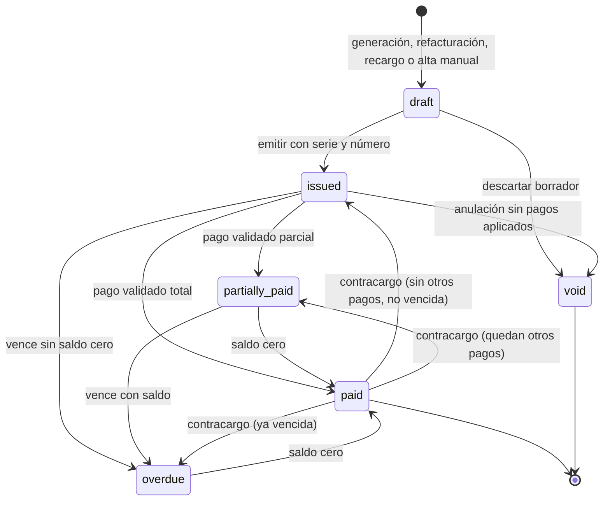

| Desde | Hacia | Disparador | Quién | Validaciones | Evento emitido | Efectos |
|---|---|---|---|---|---|---|
| — | draft | `GenerateRenewalInvoices` (RN-BIL-001); carga de `provider_bills` (RN-BIL-004); recargo por mora (RN-BIL-015); comisión de medio de pago sobre factura emitida (RN-BIL-013); alta manual | Sistema; `finance` con `billing.invoice.create` | Moneda PEN/USD; `legal_entity_id` único; tratamiento `taxed`/`export` resuelto (RN-BIL-008); un solo borrador por suscripción y periodo (RN-BIL-002) | `InvoiceDrafted` | Cálculo de líneas, IGV y detracción |
| draft | issued | Acción `POST /admin/invoices/{id}/issue` o regla de automatización que la invoca | `finance` con `billing.invoice.issue`; sistema por regla | `Idempotency-Key`; al menos una línea; tipo de cambio disponible si aplica; configuración de detracción definida si el producto está alcanzado (RN-BIL-010); número asignado con bloqueo de `document_series` (RN-BIL-016) | `InvoiceIssued` | `fiscal_status` pasa a `pending`; PDF con plantilla de la marca; calendario de cobranza calculado (RN-BIL-030) |
| draft | void | Descartar borrador | `finance` con `billing.invoice.void` | Sin número asignado | `InvoiceVoided` | Ninguno fiscal |
| issued | partially_paid | Oyente de `PaymentValidated` con aplicación menor al saldo | Sistema | `payment_allocations` en la misma moneda o convertida | `InvoicePartiallyPaid` | `balance_minor` recalculado |
| issued / partially_paid / overdue | paid | Oyente de `PaymentValidated` que deja saldo cero; retención de IGV registrada (RN-BIL-012) | Sistema | `balance_minor = 0` | `InvoicePaid` | Renueva o reactiva servicios; compromiso `kept`; pedido a `payment_validated` |
| issued / partially_paid | overdue | Job diario de cobranza | Sistema | `due_date` < hoy en zona del cliente y `balance_minor > 0` | `InvoiceOverdue` | Etapas posteriores al vencimiento; recargo por mora (RN-BIL-015) |
| paid | issued / partially_paid / overdue | Oyente de `PaymentChargedBack`: se revierte la aplicación del pago con tarjeta | Sistema | Saldo recalculado > 0; `overdue` si `due_date` < hoy, `partially_paid` si quedan otras aplicaciones, si no `issued` (RN-BIL-061) | `InvoiceReopened` | La factura vuelve a la cobranza; los servicios renovados no se suspenden de inmediato: siguen la secuencia de cobranza desde la etapa que corresponda a su vencimiento |
| issued | void | Anulación (comunicación de baja o nota de crédito total) | `finance` con `billing.invoice.void` | Sin pagos aplicados; la anulación fiscal se tramita en la máquina fiscal | `InvoiceVoided` | Servicio enlazado sin factura vigente vuelve a la detección de "sin facturar" |

Una factura `overdue` que recibe un pago parcial sigue `overdue` (el vencimiento prevalece) hasta llegar a saldo cero. Una factura emitida no se edita; se corrige con nota de crédito o débito enlazada (RN-BIL-017).

---

## 4. `invoices.fiscal_status`

Estados: `not_applicable`, `pending`, `accepted`, `rejected`, `voided`.

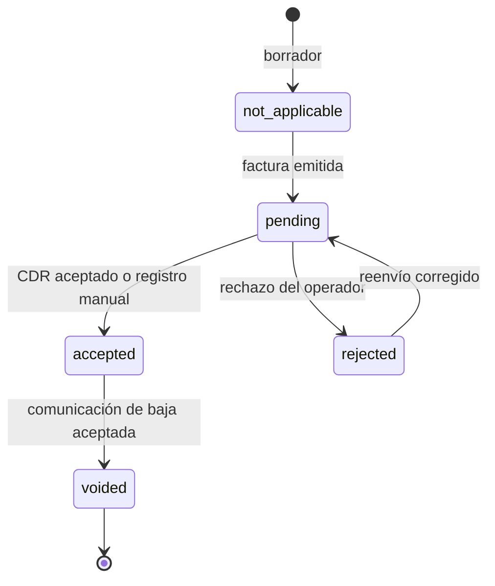

| Desde | Hacia | Disparador | Quién | Validaciones | Evento emitido | Efectos |
|---|---|---|---|---|---|---|
| — | not_applicable | Creación del borrador | Sistema | — | — | — |
| not_applicable | pending | `InvoiceIssued` | Sistema | Factura en `issued` | `EInvoiceQueued` | Job en cola `billing` crea `einvoice_submissions`, también para clientes del extranjero (RN-BIL-021) |
| pending | accepted | Respuesta del conector de facturación electrónica | Sistema | XML y CDR guardados en `files` | `EInvoiceAccepted` | PDF definitivo disponible en el portal |
| pending | accepted | Emisión externa sin conector (alternativa manual) | `finance` con `billing.invoice.issue` | Número externo, XML y CDR adjuntos | `EInvoiceAccepted` | Igual |
| pending | rejected | Respuesta de rechazo | Sistema | Código y motivo guardados | `EInvoiceRejected` | Alerta y tarea para finanzas |
| rejected | pending | Reenvío tras corregir | `finance` con `billing.invoice.issue` | No se emite número nuevo | `EInvoiceQueued` | Nuevo `einvoice_submissions` |
| accepted | voided | Comunicación de baja aceptada | Sistema tras acción de `finance` con `billing.invoice.void` | `invoices.status = void` | `EInvoiceVoided` | — |

---

## 5. `payments.status`

Estados: `reported`, `validated`, `rejected`, `refunded`, `charged_back`. Finales: `rejected`, `refunded`; `charged_back` es final si el contracargo se pierde.

El estado "en validación" que menciona el kit en §7 no existe en el contrato: un pago `reported` es, por definición, un pago en la cola de validación de finanzas. El pago con tarjeta no pasa por esa cola: nace `validated` con el webhook aprobado de la pasarela (docs/00 §21).

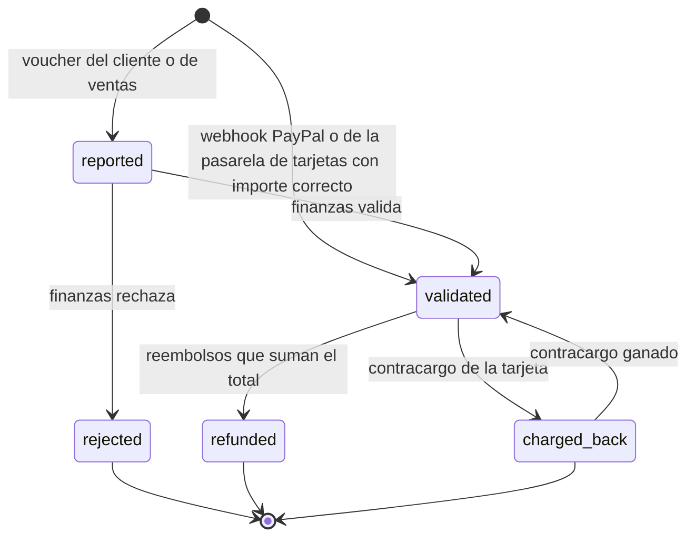

| Desde | Hacia | Disparador | Quién | Validaciones | Evento emitido | Efectos |
|---|---|---|---|---|---|---|
| — | reported | Envío de voucher desde el portal o registro de ventas o finanzas; webhook de PayPal o de la pasarela de tarjetas cuyo importe no coincide | `customer_admin`/`customer_user` con `portal.payment.create`; `sales`/`finance` con `billing.payment.create`; sistema | `Idempotency-Key`; archivo de comprobante (`proof_file_id`) salvo webhook; moneda PEN/USD | `PaymentReported` | Aparece en la bandeja de validación de finanzas. No salda ni reactiva (RN-BIL-050); importe distinto abre alerta |
| — | validated | Webhook PayPal de captura completada | Sistema | Firma válida; `webhook_events` con id externo único; `payments.external_id` único por método; importe y moneda coinciden (RN-BIL-052) | `PaymentValidated` | Aplicación a facturas; `fee_minor` como gasto (RN-BIL-014) |
| — | validated | Webhook de la pasarela de tarjetas con pago aprobado | Sistema | Firma HMAC válida; evento único en `webhook_events` (`provider = card_gateway`); intento `payment_checkouts` en `created` con el mismo importe y moneda; `external_id` único por método (RN-BIL-059) | `PaymentValidated` | Aplicación a las facturas del intento (más antigua primero); línea "Comisión por medio de pago" si se traslada (RN-BIL-013); comisión estimada en `fee_minor` hasta la liquidación (RN-BIL-063) |
| reported | validated | Validación del voucher | `finance` con `billing.payment.validate` | Importe, moneda, comprobante; `validated_by` registrado | `PaymentValidated` | `payment_allocations`; recalcula saldo; excedente a `credit_balances` (RN-BIL-056) |
| reported | rejected | Rechazo del voucher | `finance` con `billing.payment.validate` | Motivo obligatorio | `PaymentRejected` | Aviso al cliente; la cobranza continúa |
| validated | refunded | Reembolso que completa el importe del pago (`payment_refunds` en `succeeded`) | `admin` con `billing.refund.authorize` | MFA de menos de `security.sensitive_action_mfa_max_age_minutes`; auditoría (RN-BIL-054) | `PaymentRefunded` | Reembolso por API (pasarela de tarjetas, PayPal) o registro manual; nota de crédito enlazada; aplicaciones revertidas. Un reembolso parcial deja el pago `validated` (RN-BIL-060) |
| validated | charged_back | Webhook de contracargo de la pasarela o registro manual de finanzas | Sistema; `finance` con `billing.payment_dispute.create` | Pago con medio `card_gateway`; contracargo con id externo único (`payment_disputes`) | `PaymentChargedBack` | Revierte las aplicaciones: la factura vuelve a tener saldo (`InvoiceReopened`); alerta `chargeback` para finanzas (RN-BIL-061) |
| charged_back | validated | Contracargo ganado (webhook o cierre manual) | Sistema; `finance` con `billing.payment_dispute.update` | `payment_disputes.status = won` | `PaymentReinstated` | Se vuelve a aplicar a las facturas con saldo; si ya fueron pagadas por otro medio, el importe va a saldo a favor (RN-BIL-062) |

---

## 6. `payment_promises.status`

Estados: `open`, `kept`, `broken`. Finales: `kept`, `broken`.

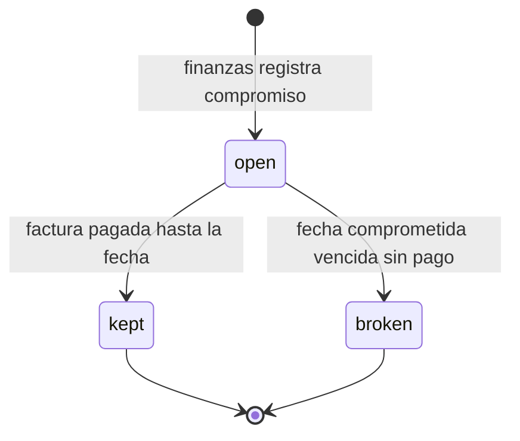

| Desde | Hacia | Disparador | Quién | Validaciones | Evento emitido | Efectos |
|---|---|---|---|---|---|---|
| — | open | Registro del compromiso | `finance` con `billing.payment_promise.create` | Factura `issued` u `overdue`; fecha comprometida igual o posterior a hoy | `PaymentPromiseCreated` | `SuspendOverdueServices` posterga la suspensión hasta esa fecha (RN-BIL-038) |
| open | kept | Oyente de `InvoicePaid` | Sistema | Pago validado con fecha no posterior a la comprometida | `PaymentPromiseKept` | — |
| open | broken | Job diario al día siguiente de la fecha comprometida | Sistema | Factura sin saldo cero | `PaymentPromiseBroken` | La cobranza continúa sola: el servicio se suspende en la siguiente ejecución (RN-BIL-039) |

---

## 7. `orders.status`

Estados: `draft`, `approved`, `payment_validated`, `provisioning`, `testing`, `active`, `manual_review`, `failed`, `cancelled`. Finales: `active`, `cancelled`.

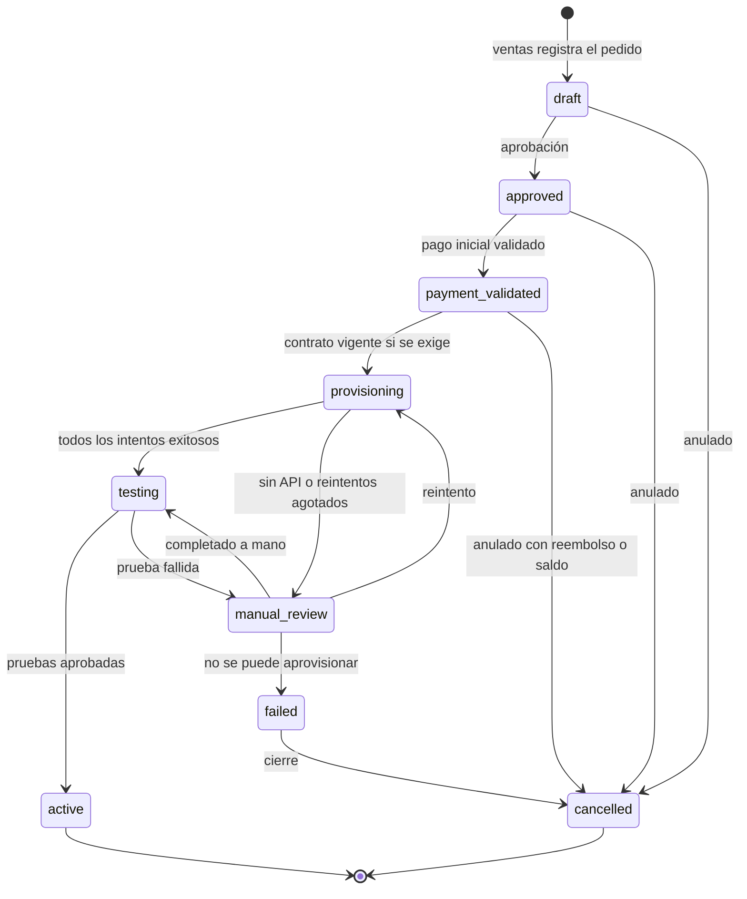

| Desde | Hacia | Disparador | Quién | Validaciones | Evento emitido | Efectos |
|---|---|---|---|---|---|---|
| — | draft | Alta desde prospecto ganado, cotización aceptada o manual | `sales` con `orders.order.create` | `Idempotency-Key`; cliente; ítems con plan | `OrderCreated` | — |
| draft | approved | Aprobación | `admin` o `finance` con `orders.order.approve` | Precios y moneda; si algún producto "requiere contrato", existe contrato en curso enlazado | `OrderApproved` | Servicios en `pending`; factura inicial en `draft`; aviso a finanzas y soporte, y a documentación si el servicio es complejo (RN-SAL-003) |
| approved | payment_validated | Oyente de `InvoicePaid` de la factura inicial | Sistema | Pago `validated` (nunca `reported`) | `OrderPaymentValidated` | — |
| payment_validated | provisioning | Oyente de `OrderPaymentValidated` o de `ContractSigned` | Sistema | Contratos exigidos en `signed_active` (RN-SRV-002); capacidad del nodo destino (RN-INV-007) | `OrderProvisioningStarted` | Una fila `provisioning_runs` (`running`) por ítem; cola `provisioning` |
| provisioning | testing | Todos los `provisioning_runs` en `succeeded` | Sistema | — | `OrderProvisioned` | Tarea de prueba para soporte con lista de verificación |
| provisioning | manual_review | `capabilities()` sin la operación, o 3 intentos fallidos (cola `provisioning`) | Sistema | Antes de cada reintento de creación se consulta si el recurso ya existe (RN-INV-008) | `OrderManualReviewRequired` | Tarea en `tasks` con el procedimiento (docs/00 §6) |
| manual_review | provisioning | Reintento | `support` con `orders.order.update` | Causa registrada | `OrderProvisioningStarted` | Nuevo `provisioning_runs` |
| manual_review | testing | Aprovisionamiento hecho a mano | `support` con `orders.order.update` | Recursos registrados y enlazados al servicio | `OrderProvisioned` | — |
| manual_review | failed | No se puede aprovisionar | `support` con `orders.order.update` | Motivo | `OrderFailed` | Aviso a ventas y finanzas |
| testing | active | Pruebas aprobadas | `support` con `orders.order.approve` | Lista de verificación completa | `OrderActivated` | Servicios a `active` (máquina 1) |
| testing | manual_review | Prueba fallida | `support` con `orders.order.update` | Motivo | `OrderManualReviewRequired` | — |
| draft / approved | cancelled | Anulación | `sales` o `admin` con `orders.order.update` | Sin pagos validados | `OrderCancelled` | Servicios `pending` a `cancelled`; factura borrador a `void` |
| payment_validated / failed | cancelled | Anulación con pago | `admin` con `orders.order.approve` | Reembolso (`billing.refund.authorize`) o saldo a favor resuelto | `OrderCancelled` | Igual |

---

## 8. `tickets.status`

Estados: `new`, `open`, `in_progress`, `waiting_customer`, `waiting_provider`, `escalated`, `resolved`, `closed`, `reopened`. Final: `closed`. Prioridades: `critical`, `high`, `medium`, `low`.

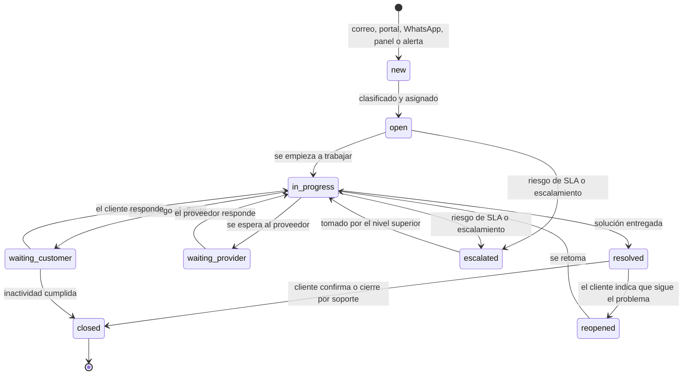

| Desde | Hacia | Disparador | Quién | Validaciones | Evento emitido | Efectos |
|---|---|---|---|---|---|---|
| — | new | Correo entrante, portal, mensaje de WhatsApp (RN-HLP-006), panel, alerta de monitoreo | Sistema; `customer_admin`/`customer_user` con `portal.ticket.create`; cualquier rol interno con `helpdesk.ticket.create` | Enlace polimórfico a servicio, dominio, servidor o plataforma cuando se conoce | `TicketCreated` | Se aplica `sla_policies` por prioridad (RN-HLP-001); se calculan `first_response_due_at` y `resolution_due_at` |
| new | open | Clasificación | `support` con `helpdesk.ticket.update` | Prioridad y responsable | `TicketAssigned` | Muestra componentes dependientes (RN-MAP-005) |
| open | in_progress | Inicio | `support` con `helpdesk.ticket.update` | — | `TicketStarted` | — |
| in_progress | waiting_customer / waiting_provider | Espera | `support` con `helpdesk.ticket.update` | Mensaje al cliente o referencia al proveedor | `TicketWaiting` | Reloj de SLA en pausa (RN-HLP-003) |
| waiting_customer | in_progress | Respuesta del cliente | Sistema (mensaje entrante) | — | `TicketResumed` | Reloj de SLA reanudado |
| waiting_provider | in_progress | Respuesta del proveedor | `support` con `helpdesk.ticket.update` | — | `TicketResumed` | Reloj reanudado |
| open / in_progress | escalated | `CheckSlaBreaches` (al umbral de alerta o al incumplir) o manual | Sistema; `support` | — | `TicketEscalated` | Alerta a destinatarios (RN-HLP-004) |
| escalated | in_progress | Tomado | `support`/`admin` con `helpdesk.ticket.update` | — | `TicketResumed` | — |
| in_progress | resolved | Solución | `support` con `helpdesk.ticket.update` | Mensaje de solución | `TicketResolved` | — |
| resolved | closed | Confirmación del cliente o cierre | `customer_admin`/`customer_user`; `support` | — | `TicketClosed` | Encuesta (`satisfaction_surveys`) |
| resolved | reopened | El cliente responde que persiste | `customer_admin`/`customer_user`; sistema por mensaje entrante | — | `TicketReopened` | Reloj de solución se reanuda |
| reopened | in_progress | Se retoma | `support` | — | `TicketStarted` | — |
| waiting_customer | closed | Job diario | Sistema | `helpdesk.auto_close.waiting_customer_days` cumplidos (RN-HLP-005) | `TicketClosed` | Aviso al cliente |

Un mensaje sobre un ticket `closed` crea un ticket nuevo enlazado en `ticket_links`.

---

## 9. `tasks.status`

Estados: `todo`, `in_progress`, `blocked`, `in_review`, `done`, `cancelled`. Finales: `done`, `cancelled`.

Las tareas nacen de tickets, alertas, renovaciones, pedidos sin API, rotación de credenciales, avisos de SSL y aprobaciones. Una tarea de aprobación (baja definitiva, revisión de dominio sin API, reinicio solicitado por el cliente) se crea directamente en `in_review`.

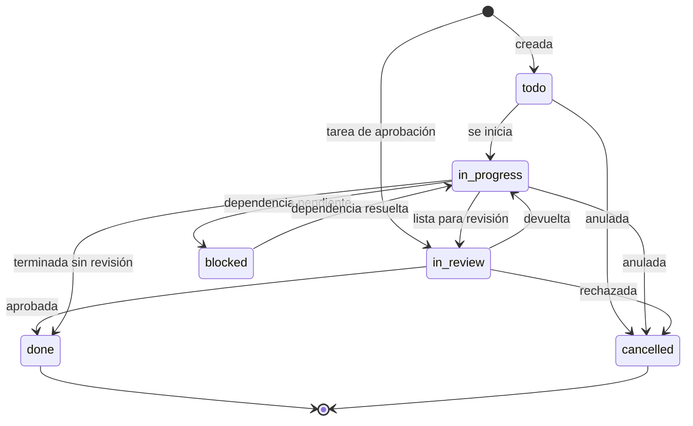

| Desde | Hacia | Disparador | Quién | Validaciones | Evento emitido | Efectos |
|---|---|---|---|---|---|---|
| — | todo | Origen (`source_type`, `source_id`) o manual | Sistema; cualquier rol con `work.task.create` | Responsable o cola | `TaskCreated` | Aviso al responsable |
| — | in_review | Aprobación requerida | Sistema | Entidad origen en el estado esperado | `TaskCreated` | Aviso a quien aprueba |
| todo | in_progress | Inicio | Responsable con `work.task.update` | — | `TaskStarted` | — |
| in_progress | blocked | Dependencia | Responsable; sistema por `task_dependencies` | Dependencia abierta | `TaskBlocked` | — |
| blocked | in_progress | Dependencia cerrada | Sistema; responsable | — | `TaskUnblocked` | — |
| in_progress | in_review | Revisión | Responsable | Lista de verificación completa (`task_checklist_items`) | `TaskSubmittedForReview` | — |
| in_review | done | Aprobación | Rol con `work.task.approve`; para tareas de aprobación, el permiso de la acción (p. ej. `services.service.terminate`) | — | `TaskCompleted` | Ejecuta o habilita la transición de la entidad origen |
| in_review | in_progress | Devuelta | Revisor | Comentario | `TaskReturned` | — |
| in_progress | done | Sin revisión requerida | Responsable | Lista completa | `TaskCompleted` | Horas en `time_entries` |
| todo / in_progress / in_review | cancelled | Anulación o rechazo | Responsable o revisor con `work.task.update` | Motivo | `TaskCancelled` | En aprobaciones, la entidad origen no cambia |

---

## 10. `leads.status`

Estados: `open`, `won`, `lost`. Finales: `won`, `lost`. La etapa del embudo (`pipeline_stages`: nuevo, contactado, propuesta enviada, negociación, ...) es un campo separado y administrable; solo las etapas finales cambian el estado.

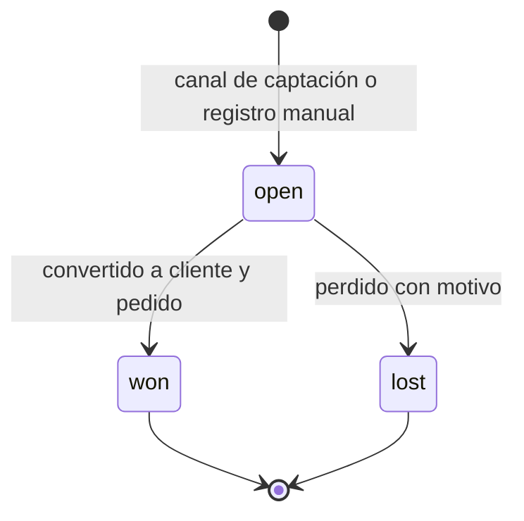

| Desde | Hacia | Disparador | Quién | Validaciones | Evento emitido | Efectos |
|---|---|---|---|---|---|---|
| — | open | Formulario web, WhatsApp, redes, mailing, referido o manual | Sistema; `sales` con `sales.lead.create` | Canal de origen registrado (RN-SAL-001); clave del formulario y anti-spam (RN-SAL-008) | `LeadCreated` | Asignación por `assignment_rules` y aviso inmediato (RN-SAL-004) |
| open | won | Conversión con un clic | `sales` con `sales.lead.update` | Deduplicación del cliente (RN-CUS-002) | `LeadWon` | Cliente y pedido `draft` creados; avisos (RN-SAL-003) |
| open | lost | Cierre | `sales` con `sales.lead.update` | Motivo obligatorio (RN-SAL-002) | `LeadLost` | — |

---

## 11. `quotes.status`

Estados: `draft`, `sent`, `accepted`, `rejected`, `expired`. Finales: `accepted`, `rejected`.

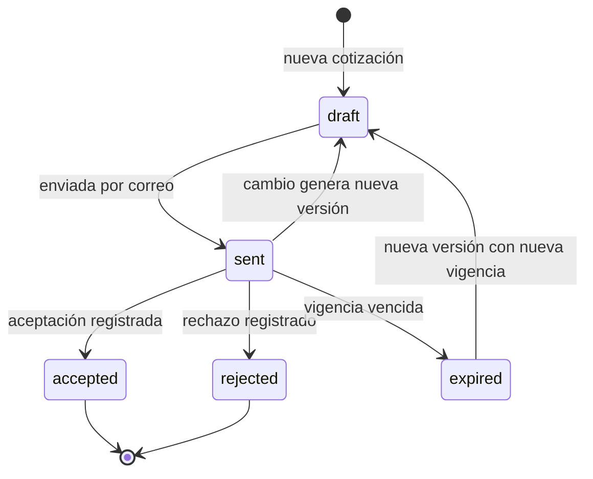

| Desde | Hacia | Disparador | Quién | Validaciones | Evento emitido | Efectos |
|---|---|---|---|---|---|---|
| — | draft | Alta | `sales` con `sales.quote.create` | Moneda PEN/USD; cargos únicos y recurrentes | `QuoteCreated` | `quote_versions` v1 |
| draft | sent | Envío desde el sistema | `sales` con `sales.quote.update` | `valid_until` desde `sales.quote.validity_days`; PDF por marca e idioma | `QuoteSent` | Correo al cliente |
| sent / expired | draft | Edición | `sales` con `sales.quote.update` | — | `QuoteVersionCreated` | Nueva `quote_versions`; la anterior se conserva (RN-SAL-007) |
| sent | accepted | Registro de aceptación | `sales` con `sales.quote.update` | Versión vigente | `QuoteAccepted` | Conversión a contrato o pedido sin redigitar |
| sent | rejected | Registro de rechazo | `sales` con `sales.quote.update` | Motivo | `QuoteRejected` | — |
| sent | expired | Job diario | Sistema | `valid_until` < hoy | `QuoteExpired` | — |

---

## 12. `contracts.status`

Estados: `draft`, `in_review`, `approved`, `sent`, `signed_active`, `expired`, `terminated`. Final: `terminated`.

Las adendas no cambian el estado del contrato: son nuevas filas de `contract_versions` enlazadas que pasan por redacción, aprobación del administrador y firma; al firmarse, la versión vigente cambia y el contrato sigue `signed_active` (RN-CTR-002).

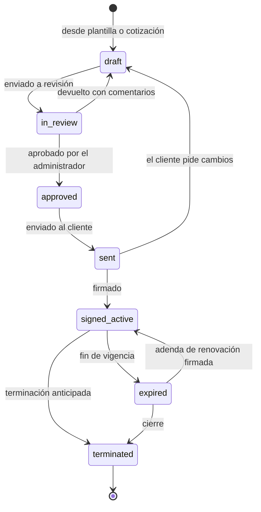

| Desde | Hacia | Disparador | Quién | Validaciones | Evento emitido | Efectos |
|---|---|---|---|---|---|---|
| — | draft | Desde `contract_templates` o cotización aceptada | `documentation` con `contracts.contract.create` | Variables resueltas | `ContractDrafted` | `contract_versions` v1 |
| draft | in_review | Envío a revisión | `documentation` con `contracts.contract.update` | — | `ContractSubmitted` | Aviso al administrador |
| in_review | draft | Devolución | `admin` | Comentario en `contract_comments` | `ContractReturned` | — |
| in_review | approved | Aprobación | `admin` con `contracts.contract.approve` | — | `ContractApproved` | — |
| approved | sent | Envío | `documentation` con `contracts.contract.update` | — | `ContractSent` | Correo o servicio de firma |
| sent | draft | Cambios del cliente | `documentation` | Nueva versión | `ContractVersionCreated` | — |
| sent | signed_active | Archivo firmado subido o webhook del servicio de firma | `documentation` con `contracts.contract.update`; sistema | Archivo firmado en `contract_signatures` (RN-CTR-003) | `ContractSigned` | Bloqueo de edición (RN-CTR-002); pedidos en espera pasan a aprovisionamiento |
| signed_active | expired | Job diario | Sistema | `ends_at` < hoy; avisos previos (`contracts.expiry_notice_days`) | `ContractExpired` | Detección de servicios sin contrato vigente |
| expired | signed_active | Adenda de renovación firmada | `documentation` | Versión aprobada y firmada | `ContractRenewed` | — |
| signed_active / expired | terminated | Terminación | `admin` con `contracts.contract.approve` | Motivo; servicios enlazados terminados, entregados o cubiertos por otro contrato | `ContractTerminated` | — |

---

## 13. `domain_operations.status`

Tipos: `contact_change`, `owner_change`, `nameserver_change`, `transfer_out`, `transfer_in`, `renewal` (`transfer_in` lo registra soporte o la sincronización cuando un dominio llega a un registrador propio; el cliente no lo solicita y entra directo en `sent`).

Estados: `requested`, `email_confirmed`, `in_review`, `sent`, `completed`, `rejected`, `cancelled`. Finales: `completed`, `rejected`, `cancelled`.

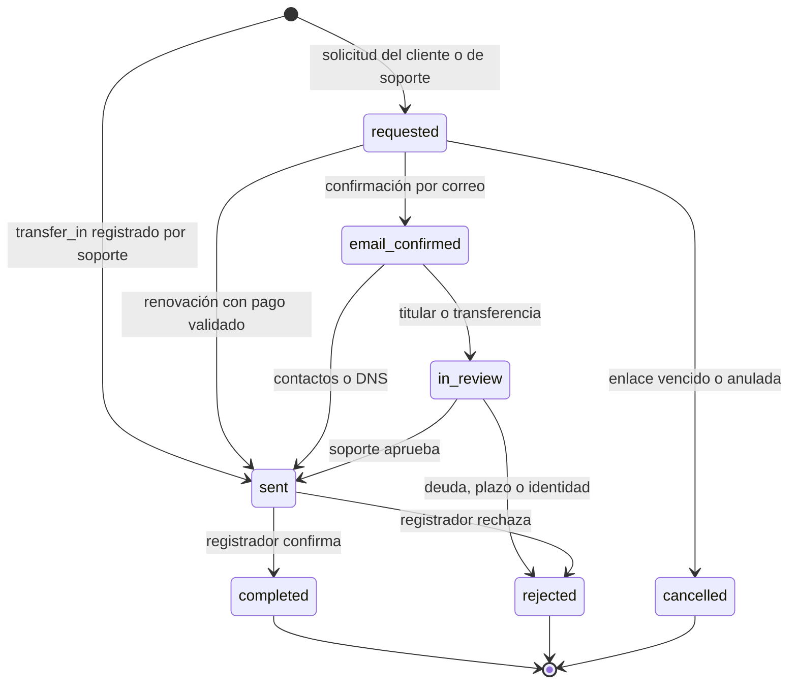

| Desde | Hacia | Disparador | Quién | Validaciones | Evento emitido | Efectos |
|---|---|---|---|---|---|---|
| — | requested | Formulario del portal o del panel | `customer_admin` con `portal.domain_operation.create` (portal); `support` con `domains.operation.create` (panel) | `Idempotency-Key`; reglas de la extensión en `tld_rules` documentadas para ccTLD (RN-DOM-009); `transfer_out`: fuera del plazo de `domains.transfer_out.min_days_since_registration_or_transfer` (RN-DOM-004); `nameserver_change` desde el portal: interruptor `portal.actions.dns_change.enabled` activo (RN-DOM-007) | `DomainOperationRequested` | Correo de confirmación al titular o contacto administrativo (RN-DOM-002) |
| — | sent | `transfer_in`: soporte registra la transferencia entrante iniciada en el registrador de destino | `support` con `domains.operation.create` | Dominio existente o creado en `domains`; `Idempotency-Key` | `DomainOperationSent` | Seguimiento hasta que el registrador confirme |
| requested | email_confirmed | Clic en el enlace | Sistema | Enlace vigente (`domains.confirmation_link_ttl_hours`) | `DomainOperationConfirmed` | — |
| requested | sent | `renewal` con pago validado | Sistema | Factura de renovación `paid` (RN-DOM-012) | `DomainOperationSent` | Renovación por API o tarea manual |
| requested | cancelled | Enlace vencido o anulación | Sistema; solicitante | — | `DomainOperationCancelled` | — |
| email_confirmed | sent | `contact_change`, `nameserver_change` | Sistema | Capacidad del conector; si no hay API, tarea para soporte (RN-DOM-008) | `DomainOperationSent` | Aviso de impacto en DNS |
| email_confirmed | in_review | `owner_change`, `transfer_out` | Sistema | — | `DomainOperationInReview` | Tarea de revisión |
| in_review | sent | Aprobación | `support` con `domains.operation.approve` | `transfer_out`: identidad y sin deudas vencidas (RN-DOM-005); `owner_change`: confirmación del titular y aviso de bloqueo (RN-DOM-006) | `DomainOperationApproved` | `transfer_out`: desbloqueo y entrega del código de autorización por enlace de un solo uso |
| in_review | rejected | Rechazo | `support` con `domains.operation.approve` | Motivo | `DomainOperationRejected` | Aviso al cliente |
| sent | completed | Respuesta del registrador o sincronización | Sistema; `support` si es manual | — | `DomainOperationCompleted` | Datos del dominio actualizados; `transfer_out` lleva el servicio a `handed_over` |
| sent | rejected | Rechazo del registrador | Sistema | — | `DomainOperationRejected` | Alerta a soporte |

---

## 14. `migration_items.status`

Estados: `pending`, `copied`, `testing`, `dns_changed`, `verified`, `closed`, `reverted`. Final: `closed`.

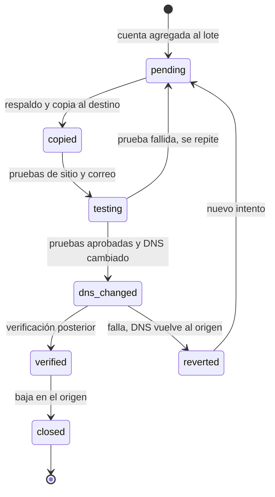

| Desde | Hacia | Disparador | Quién | Validaciones | Evento emitido | Efectos |
|---|---|---|---|---|---|---|
| — | pending | Armado del lote (`migration_batches`) | `support` con `inventory.migration_batch.create` | Nodo destino con capacidad (RN-INV-001) | `MigrationItemQueued` | Orden por tamaño y riesgo |
| pending | copied | Copia | Sistema (WHM con acceso root) o `support` con `inventory.migration_item.update` | Respaldo previo exitoso (RN-INV-002) | `MigrationItemCopied` | — |
| copied | testing | Inicio de pruebas | `support` | — | `MigrationItemTesting` | Lista de verificación de sitio y correo |
| testing | dns_changed | Pruebas aprobadas y cambio de DNS | `support` con `inventory.migration_item.update` | Lista completa | `MigrationItemDnsChanged` | — |
| testing | pending | Prueba fallida | `support` | Motivo | `MigrationItemRetry` | — |
| dns_changed | verified | Verificación | `support` | Sitio y correo responden desde el destino | `MigrationItemVerified` | — |
| dns_changed | reverted | Falla tras el cambio | `support` | DNS restaurado al origen (RN-INV-005) | `MigrationItemReverted` | — |
| verified | closed | Baja en el origen | `support` | Solo desde `verified` (RN-INV-004) | `MigrationItemClosed` | Mapa de servicios y `hosting_accounts` apuntan al destino (RN-INV-003); espacio liberado en el tablero |
| reverted | pending | Nuevo intento | `support` | — | `MigrationItemRetry` | — |

---

## 15. `incidents.status`

Estados: `open`, `monitoring`, `resolved`. Final: `resolved`.

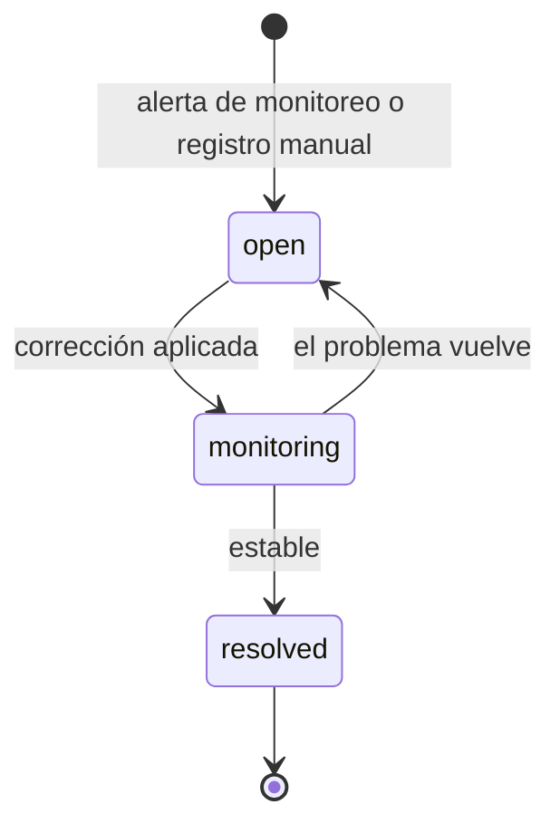

| Desde | Hacia | Disparador | Quién | Validaciones | Evento emitido | Efectos |
|---|---|---|---|---|---|---|
| — | open | Alerta (`alerts`) o registro | Sistema; `support` con `monitoring.incident.create` | Recurso o componente afectado | `IncidentOpened` | `incident_affected` se llena con los servicios, instancias SaaS y clientes que dependen del recurso (RN-MAP-005, RN-CLD-008); tickets enlazados; aviso a clientes afectados y portal de estado |
| open | monitoring | Corrección | `support` con `monitoring.incident.update` | Nota de la acción | `IncidentMitigated` | — |
| monitoring | open | Recurrencia | Sistema; `support` | — | `IncidentReopened` | — |
| monitoring | resolved | Cierre | `support` con `monitoring.incident.update` | Causa registrada | `IncidentResolved` | Aviso de resolución; si es recurrente, `problems` |

---

## 16. `account_handovers.status`

Estados: `scheduled`, `in_progress`, `completed`. Final: `completed`.

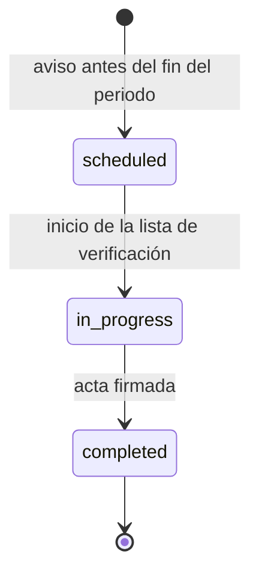

| Desde | Hacia | Disparador | Quién | Validaciones | Evento emitido | Efectos |
|---|---|---|---|---|---|---|
| — | scheduled | Job diario según `contracts.account_handover.notice_days` antes del fin del periodo; o alta manual | Sistema; `documentation` con `contracts.account_handover.create` | Servicio con modalidad `managed_new_account_handover` y fecha de fin | `AccountHandoverScheduled` | Aviso al cliente y a soporte |
| scheduled | in_progress | Inicio | `documentation` o `support` con `contracts.account_handover.update` | — | `AccountHandoverStarted` | Lista: cambio de titular, cambio de medio de pago, retiro de accesos de la empresa, rotación de credenciales, acta |
| in_progress | completed | Cierre | `documentation` con `contracts.account_handover.update` | Lista completa y acta firmada adjunta (RN-CTR-008) | `AccountHandoverCompleted` | Servicio a `handed_over`; concesiones de la bóveda revocadas y tareas de rotación (RN-VLT-003); `cloud_accounts.owner = customer` |

---

## 17. `payment_checkouts.status`

Estados: `created`, `approved`, `declined`, `expired`, `cancelled`. Finales: `approved`, `declined`, `expired`, `cancelled`.

Un intento de pago con tarjeta desde el portal (docs/00 §21). El sistema nunca recibe datos de tarjeta: el cliente los escribe en el formulario alojado o tokenizado por la pasarela. Un rechazo no se reintenta sobre el mismo intento: el cliente inicia otro.

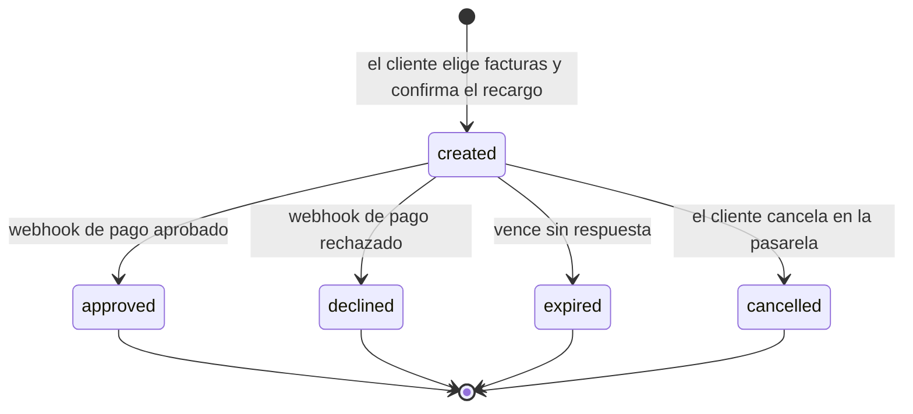

| Desde | Hacia | Disparador | Quién | Validaciones | Evento emitido | Efectos |
|---|---|---|---|---|---|---|
| — | created | `POST /portal/payments/card-checkouts` | `customer_admin`/`customer_user` con `portal.payment.create` | `Idempotency-Key`; facturas propias, emitidas, con saldo y de la misma moneda; moneda en `billing.card_gateway.currencies`; medio `card_gateway` activo y `billing.card_gateway.provider` definido (RN-BIL-058) | `PaymentCheckoutCreated` | Sesión creada en la pasarela con `createOrder()`; vence a los `billing.card_gateway.checkout_expiry_minutes` |
| created | approved | Webhook firmado de pago aprobado | Sistema | Importe y moneda iguales a `amount_minor` y `currency` del intento; transacción no registrada antes | `PaymentCheckoutApproved` | Crea el pago `validated` (sección 5) y lo enlaza en `payment_id` |
| created | declined | Webhook firmado de pago rechazado | Sistema | Código de rechazo de la pasarela | `PaymentCheckoutDeclined` | El portal muestra el motivo traducido; las facturas siguen pendientes |
| created | expired | Job `ExpireCardCheckouts` | Sistema | `expires_at` < ahora sin webhook | `PaymentCheckoutExpired` | Antes de marcarlo, consulta la transacción en la pasarela; si estaba aprobada, sigue la fila `approved` |
| created | cancelled | Regreso del cliente con cancelación informada por la pasarela | Sistema | La pasarela confirma que no hubo cobro | `PaymentCheckoutCancelled` | — |

---

## 18. `payment_refunds.status`

Estados: `requested`, `processing`, `succeeded`, `failed`. Finales: `succeeded`, `failed`.

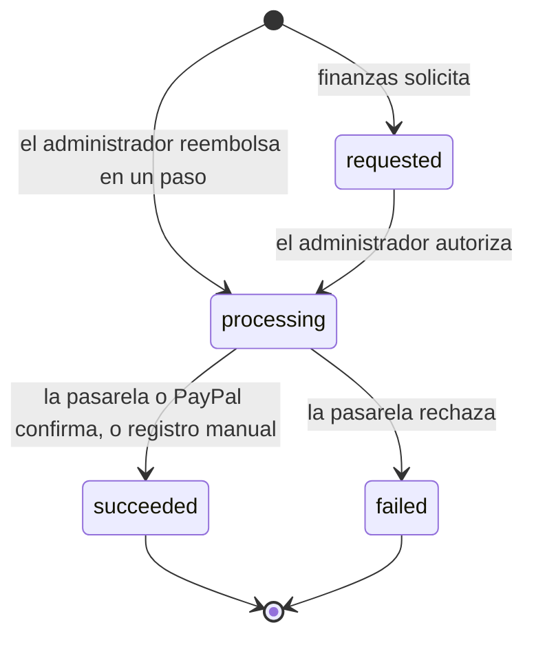

| Desde | Hacia | Disparador | Quién | Validaciones | Evento emitido | Efectos |
|---|---|---|---|---|---|---|
| — | requested | `POST /admin/payments/{id}/refunds` | `finance` con `billing.payment.validate` | `Idempotency-Key`; pago `validated`; motivo; la suma de reembolsos no supera el pago (RN-BIL-060) | `PaymentRefundRequested` | Aviso al administrador |
| requested | processing | `POST /admin/payments/{id}/refunds/{refundId}/authorize` | `admin` con `billing.refund.authorize` | MFA reciente; quien solicitó no autoriza (salvo administrador) (RN-BIL-054) | `PaymentRefundAuthorized` | `refund()` del conector con la misma clave de idempotencia; sin conector, pide la referencia del reembolso manual |
| — | processing | `POST /admin/payments/{id}/refund` | `admin` con `billing.refund.authorize` | Igual | `PaymentRefundAuthorized` | Igual |
| processing | succeeded | Respuesta del conector o webhook de reembolso; registro manual con referencia | Sistema; `admin` | `external_id` único por pago | `PaymentRefundSucceeded` | Nota de crédito enlazada (`credit_note_id`); si la suma iguala el pago, `payments.status = refunded` |
| processing | failed | Rechazo de la pasarela | Sistema | Motivo de la pasarela | `PaymentRefundFailed` | Alerta a finanzas; se puede solicitar de nuevo |

---

## 19. `payment_disputes.status`

Estados: `open`, `evidence_submitted`, `won`, `lost`. Finales: `won`, `lost`.

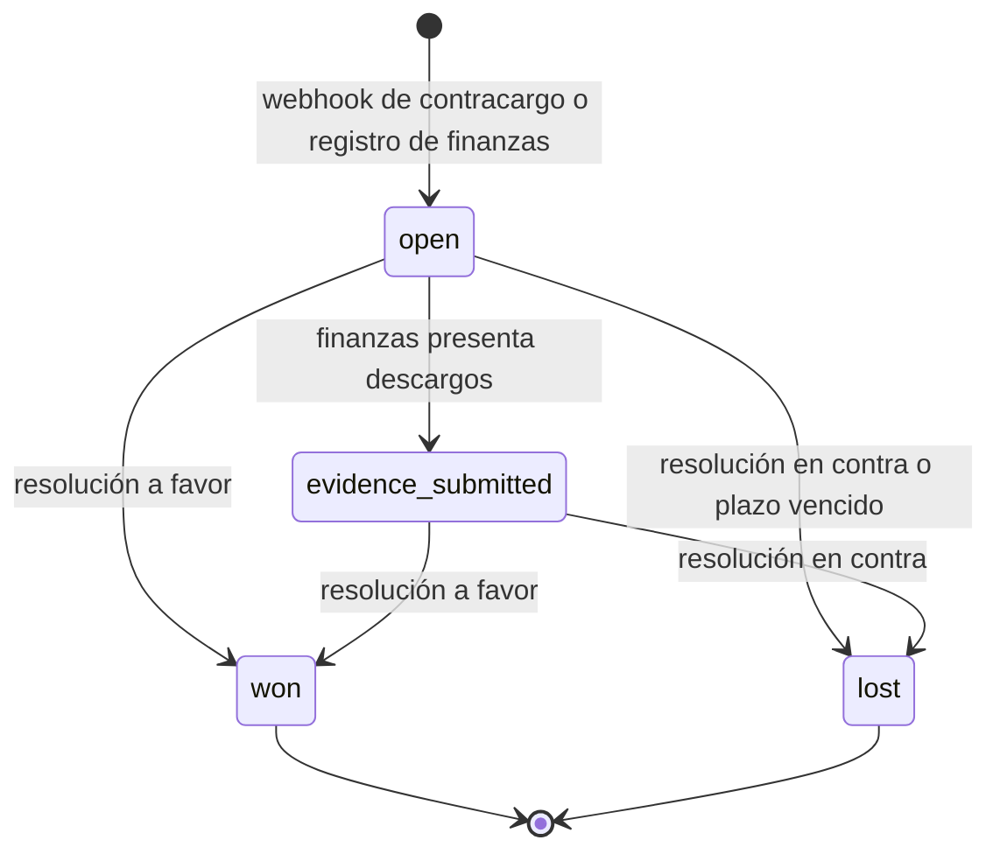

| Desde | Hacia | Disparador | Quién | Validaciones | Evento emitido | Efectos |
|---|---|---|---|---|---|---|
| — | open | Webhook de contracargo de la pasarela; `POST /admin/payment-disputes` (sin webhook) | Sistema; `finance` con `billing.payment_dispute.create` | Pago `validated` con medio `card_gateway`; id externo único por pago | `PaymentDisputeOpened` | Pago a `charged_back`; factura con saldo; alerta `chargeback` con la fecha límite `respond_by` (RN-BIL-061) |
| open | evidence_submitted | `POST /admin/payment-disputes/{id}/evidence` | `finance` con `billing.payment_dispute.update` | Archivo de sustento | `PaymentDisputeEvidenceSubmitted` | — |
| open / evidence_submitted | won | Webhook de resolución o `POST /admin/payment-disputes/{id}/resolve` | Sistema; `finance` con `billing.payment_dispute.update` | — | `PaymentDisputeWon` | Pago vuelve a `validated` (RN-BIL-062); alerta resuelta |
| open / evidence_submitted | lost | Webhook de resolución o cierre manual | Sistema; `finance` con `billing.payment_dispute.update` | — | `PaymentDisputeLost` | El pago queda `charged_back`; la factura sigue en cobranza; el importe retenido por la pasarela se concilia como línea `chargeback` |

---

## 20. `wp_sites.status`

Estados: `pending`, `active`, `disabled`. Sin estado final: un sitio desactivado puede volver a activarse; la baja es lógica.

Un sitio de WordPress Multisite conectado a una marca (docs/00 §26, módulo WCN). Mientras está `pending` el plugin puede leer con un token vigente para configurarse, pero el sistema no le envía avisos; `active` recibe los avisos de invalidación; `disabled` deja de recibirlos y el plugin sigue con su última copia.

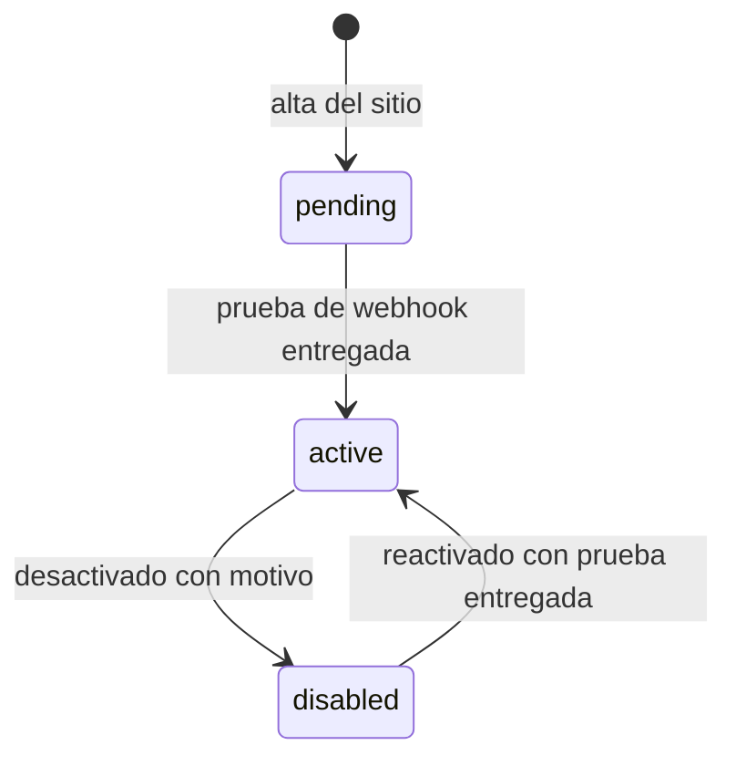

| Desde | Hacia | Disparador | Quién | Validaciones | Evento emitido | Efectos |
|---|---|---|---|---|---|---|
| — | pending | `POST /admin/web-connector/sites` | `admin` con `web_connector.site.create` | URL HTTPS única en todo el sistema; marca de la organización (RN-WCN-002) | `WpSiteCreated` | — |
| pending / disabled | active | `POST /admin/web-connector/sites/{id}/activate` | `admin` o `sales` con `web_connector.site.update` | Ruta del plugin, secreto de firma, token vigente y una invalidación de prueba `delivered` (RN-WCN-002) | `WpSiteActivated` | Primer aviso `all` para que el plugin renueve todo |
| active | disabled | `POST /admin/web-connector/sites/{id}/disable` | `admin` o `sales` con `web_connector.site.update` | Motivo | `WpSiteDisabled` | Se cancelan los avisos pendientes del sitio |
| cualquiera | (baja) | `DELETE /admin/web-connector/sites/{id}` | `admin` con `web_connector.site.delete` | — | `WpSiteDisabled` | Revoca sus tokens (`WpSiteTokenRevoked`) |

Crear o revocar un token (`POST …/tokens`, `POST …/tokens/{tokenId}/revoke`) no cambia el estado del sitio; un token revocado no se reactiva (RN-WCN-003).

---

## 21. `web_forms.status`

Estados: `draft`, `active`, `inactive`. Sin estado final.

Formulario del constructor (WCN). Solo uno `active` se muestra con `[hub_formulario]` y acepta envíos; `inactive` muestra un aviso con los datos de contacto de la marca.

```mermaid
stateDiagram-v2
    [*] --> draft : alta del formulario
    draft --> active : activado
    active --> inactive : desactivado
    inactive --> active : reactivado
```

| Desde | Hacia | Disparador | Quién | Validaciones | Evento emitido | Efectos |
|---|---|---|---|---|---|---|
| — | draft | `POST /admin/web-connector/forms` | `sales` o `admin` con `web_connector.form.create` | Código único por marca; destino completo (RN-WCN-010) | — | — |
| draft / inactive | active | `POST /admin/web-connector/forms/{id}/activate` | `sales` o `admin` con `web_connector.form.update` | Al menos un campo; mensaje de confirmación; consentimiento con texto si es obligatorio | `WebFormActivated` | Aviso `form` a los sitios de la marca |
| active | inactive | `POST /admin/web-connector/forms/{id}/deactivate` | `sales` o `admin` con `web_connector.form.update` | — | `WebFormDeactivated` | Aviso `form` a los sitios de la marca |

## 22. `carts.status`

Estados: `open`, `abandoned`, `converted`, `expired`. Finales: `converted`, `expired`.

```mermaid
stateDiagram-v2
    [*] --> open : primer producto agregado en la web
    open --> abandoned : sin actividad
    abandoned --> open : el visitante vuelve
    open --> converted : compra completada
    open --> expired : vence sin actividad
    abandoned --> expired : vence sin actividad
    converted --> [*]
    expired --> [*]
```

| Desde | Hacia | Disparador | Quién | Validaciones | Evento emitido | Efectos |
|---|---|---|---|---|---|---|
| — | open | `POST /public/carts` | Visitante (público) | Marca de origen activa; `orders.online.enabled` de la marca; moneda PEN o USD | `CartCreated` | Token en cookie segura; vence a los `orders.online.cart_expiry_days` |
| open | abandoned | Job `DetectAbandonedCarts` | Sistema | Sin actividad en `orders.online.abandoned_cart_after_hours`; al menos una línea | `CartAbandoned` | Un único aviso si `orders.online.abandoned_cart_notice_enabled` y el contacto tiene consentimiento comercial (RN-ORD-010) |
| abandoned | open | Cualquier cambio o consulta del carrito | Visitante | — | `CartRecovered` | — |
| open | converted | Oyente de `CheckoutSessionCompleted` | Sistema | Compra `completed` del carrito | `CartConverted` | — |
| open / abandoned | expired | Job `DetectAbandonedCarts` | Sistema | `expires_at` < ahora | `CartExpired` | — |

---

## 23. `checkout_sessions.status`

Estados: `open`, `manual_review`, `awaiting_payment`, `awaiting_validation`, `paid`, `completed`, `expired`, `cancelled`. Finales: `completed`, `expired`, `cancelled`.

La compra en línea confirmada por un cliente con sesión (docs/00 §25, pasos 4 a 6). El pedido y la factura se crean solo en `paid → completed`; un voucher `reported` no crea nada (RN-ORD-006).

```mermaid
stateDiagram-v2
    [*] --> open : cliente con sesión confirma el carrito y acepta términos
    [*] --> manual_review : compra atípica o cliente nuevo sobre el límite
    manual_review --> open : aprobada
    manual_review --> cancelled : rechazada
    open --> awaiting_payment : pago con tarjeta o PayPal iniciado
    awaiting_payment --> open : pago rechazado o cancelado
    awaiting_payment --> paid : webhook de pago aprobado
    open --> awaiting_validation : voucher enviado
    awaiting_validation --> paid : finanzas valida el voucher
    awaiting_validation --> open : voucher rechazado
    paid --> completed : pedido y factura creados
    open --> expired : vence
    awaiting_payment --> expired : vence sin pago
    manual_review --> expired : vence sin decisión
    open --> cancelled : el cliente cancela
    completed --> [*]
    expired --> [*]
    cancelled --> [*]
```

| Desde | Hacia | Disparador | Quién | Validaciones | Evento emitido | Efectos |
|---|---|---|---|---|---|---|
| — | open | `POST /portal/checkout-sessions` | `customer_admin` con `portal.order.create` | `Idempotency-Key`; carrito abierto de la organización con líneas en venta en línea (RN-ORD-001); precios recalculados del catálogo; captcha; términos aceptados; una compra en curso por carrito | `CheckoutSessionStarted` | Total congelado en `snapshot`; vence a las `orders.online.checkout_expiry_hours` |
| — | manual_review | Igual | Igual | Supera `orders.online.new_customer_max_open_checkouts` o una regla de `orders.online.manual_review_rules` (RN-ORD-008, RN-ORD-009) | `CheckoutSessionReviewRequired` | `review_reason` y `risk_flags`; tarea o aviso a finanzas; el cliente ve "estamos revisando tu pedido" |
| manual_review | open | `POST /admin/checkout-sessions/{id}/approve` | `finance` o `admin` con `orders.checkout_session.approve` | Motivo | `CheckoutSessionApproved` | Aviso al cliente con el enlace para pagar |
| manual_review | cancelled | `POST /admin/checkout-sessions/{id}/reject` | `finance` o `admin` con `orders.checkout_session.approve` | Motivo | `CheckoutSessionCancelled` | Aviso al cliente; sin cobro |
| open | awaiting_payment | `POST .../card-payment` o `.../paypal-order` | `customer_admin` con `portal.order.create` | `Idempotency-Key`; correo verificado (RN-ORD-004); medio activo; importe = total + recargo | `CheckoutSessionPaymentStarted` | `payment_checkouts` con `checkout_session_id` (tarjeta) u orden de PayPal |
| awaiting_payment | open | Oyente de `PaymentCheckoutDeclined`, `PaymentCheckoutCancelled` o `PaymentCheckoutExpired` | Sistema | — | `CheckoutSessionPaymentFailed` | El cliente puede intentar otro medio |
| awaiting_payment | paid | Oyente de `PaymentCheckoutApproved` o captura de PayPal | Sistema | Pago `validated` por webhook con importe y moneda iguales | `CheckoutSessionPaid` | `payment_id`, `paid_at` |
| open | awaiting_validation | `POST .../voucher` | `customer_admin` con `portal.order.create` | `Idempotency-Key`; correo verificado; archivo de voucher | `CheckoutSessionPaymentReported` | Pago `reported` con `checkout_session_id`; alerta a finanzas tras `orders.online.voucher_validation_alert_hours` |
| awaiting_validation | paid | Oyente de `PaymentValidated` | Sistema (finanzas valida con `billing.payment.validate`) | Pago enlazado `validated` | `CheckoutSessionPaid` | — |
| awaiting_validation | open | Oyente de `PaymentRejected` | Sistema | — | `CheckoutSessionPaymentFailed` | Aviso al cliente con el motivo |
| paid | completed | Job `CompletePaidCheckout` (o `POST /admin/checkout-sessions/{id}/complete`) | Sistema; `finance` o `admin` con `orders.checkout_session.update` | Una compra genera un solo pedido (`orders.checkout_session_id` único, RN-ORD-005) | `CheckoutSessionCompleted` | Pedido `online` aprobado por el sistema con la marca de origen; factura emitida y pago aplicado; la máquina 7 sigue a `payment_validated` → `provisioning` |
| open / awaiting_payment / manual_review | expired | Job `ExpireCheckoutSessions` | Sistema | `expires_at` < ahora; antes de vencer `awaiting_payment` se consulta la transacción en la pasarela | `CheckoutSessionExpired` | — |
| open | cancelled | `POST .../cancel` | `customer_admin` con `portal.order.create` | Sin pago en curso | `CheckoutSessionCancelled` | — |

---

## 24. `restore_requests.status`

Estados: `requested`, `approved`, `rejected`, `in_progress`, `completed`, `failed`, `cancelled`. Finales: `rejected`, `completed`, `failed`, `cancelled`.

```mermaid
stateDiagram-v2
    [*] --> requested : el cliente o soporte la pide
    requested --> approved : soporte aprueba
    requested --> rejected : soporte rechaza
    requested --> cancelled : el cliente cancela
    approved --> in_progress : se inicia la restauración
    approved --> cancelled : el cliente cancela
    in_progress --> completed : restaurado con evidencia
    in_progress --> failed : no se pudo restaurar
    rejected --> [*]
    completed --> [*]
    failed --> [*]
    cancelled --> [*]
```

| Desde | Hacia | Disparador | Quién | Validaciones | Evento emitido | Efectos |
|---|---|---|---|---|---|---|
| — | requested | `POST /portal/restore-requests` o `POST /admin/restore-requests` | `customer_admin` con `portal.restore_request.create`; `support` con `monitoring.restore_request.create` | `Idempotency-Key`; servicio propio; tipo en `monitoring.restore.customer_target_kinds`; confirmación de sobrescritura; una solicitud abierta por objeto (RN-MON-001) | `RestoreRequested` | Código `RST-…`; ticket del cliente (tipo `request`) enlazado |
| requested | approved | `POST /admin/restore-requests/{id}/approve` | `support` o `admin` con `monitoring.restore_request.approve` | Punto de restauración disponible; quien registró la solicitud por el cliente no aprueba (RN-MON-002) | `RestoreRequestApproved` | Aviso en el ticket |
| requested | rejected | `POST /admin/restore-requests/{id}/reject` | `support` o `admin` con `monitoring.restore_request.approve` | Motivo visible al cliente | `RestoreRequestRejected` | Aviso en el ticket |
| requested / approved | cancelled | `POST /portal/restore-requests/{id}/cancel` | `customer_admin` con `portal.restore_request.update` | Aún no empezó | `RestoreRequestCancelled` | Nota en el ticket |
| approved | in_progress | `POST /admin/restore-requests/{id}/start` | `support` con `monitoring.restore_request.update` | `Idempotency-Key`; con API de la herramienta habilitada en el nodo: `execution_mode = api`; si no: `assisted` con tarea (RN-MON-003) | `RestoreRequestStarted` | Restauración por `BackupToolConnector` o tarea en `tasks` (`source_type = restore_request`) |
| in_progress | completed | `POST /admin/restore-requests/{id}/complete` o fin del trabajo de la herramienta | `support` con `monitoring.restore_request.update`; Sistema | Evidencia adjunta (RN-MON-004) | `RestoreRequestCompleted` | Evidencia en el ticket; aviso al cliente |
| in_progress | failed | `POST /admin/restore-requests/{id}/fail` o error de la herramienta | `support`; Sistema | Resultado registrado | `RestoreRequestFailed` | El ticket sigue abierto; alerta a soporte |

---

## 25. `ai_conversations.status`

Estados: `active`, `handed_off`, `limit_reached`, `closed`. Final: `closed`.

```mermaid
stateDiagram-v2
    [*] --> active : el visitante o cliente abre el asistente
    active --> handed_off : pide una persona o WhatsApp
    active --> limit_reached : tope por conversación o mensual
    limit_reached --> handed_off : acepta hablar con una persona
    active --> closed : inactiva o cerrada
    handed_off --> closed : cierre
    limit_reached --> closed : cierre
    closed --> [*]
```

| Desde | Hacia | Disparador | Quién | Validaciones | Evento emitido | Efectos |
|---|---|---|---|---|---|---|
| — | active | `POST /public/assistant/conversations` o `POST /portal/assistant/conversations` | Visitante (público); `customer_user`/`customer_admin` con `portal.assistant_conversation.create` | `assistant.enabled` de la marca; perfil activo; límite por IP en la web; tope mensual no alcanzado | `AiConversationStarted` | Saludo que lo presenta como asistente automático (RN-AIA-001) |
| active / limit_reached | handed_off | `POST .../handoff` o herramienta `handoff` | Visitante o cliente; Sistema | Datos de contacto en la web | `AiConversationHandedOff` | Prospecto asignado (web) o ticket (portal) con la conversación; enlace a WhatsApp si se eligió |
| active | limit_reached | Al enviar un mensaje | Sistema | Supera `assistant.max_messages_per_conversation` o `assistant.monthly_token_limit` de la marca (RN-AIA-007) | `AiConversationLimitReached` | Solo opciones de contacto humano |
| active / handed_off / limit_reached | closed | Job `CloseIdleAiConversations` o `POST /admin/assistant/conversations/{id}/close` | Sistema; `sales` o `support` con `assistant.conversation.update` | — | `AiConversationClosed` | — |

---

## 26. `brand_theme_versions.status`

Estados: `draft`, `published`, `archived`. Final: ninguno (una versión `archived` puede volver a publicarse mediante una copia).

Tema del portal y el carrito, el panel y los correos (la web pública usa el tema de WordPress). Una marca tiene un solo tema (`brand_themes`) y, como máximo, una versión `published` a la vez (RN-BRD-001). Volver a una versión anterior no cambia la versión archivada: crea una versión nueva copiada de ella (`restored_from_version_id`) que se publica con el mismo control de contraste.

```mermaid
stateDiagram-v2
    [*] --> draft : borrador nuevo o copia de otra versión
    draft --> published : admin publica con contraste verificado
    draft --> archived : se descarta el borrador
    published --> archived : se publica otra versión de la marca
    archived --> [*]
```

| Desde | Hacia | Disparador | Quién | Validaciones | Evento emitido | Efectos |
|---|---|---|---|---|---|---|
| — | draft | `POST /admin/brand-themes/{id}/versions` (o `.../revert`, que crea la copia) | `sales` o `admin` con `brands.theme.update`; `admin` con `brands.theme.approve` al revertir | Tokens dentro de la lista permitida (`brands.theme.allowed_fonts`, colores hexadecimales, opciones cerradas); sin CSS ni JavaScript libres (RN-BRD-002) | `BrandThemeVersionDrafted` | Número de versión siguiente |
| draft | draft | `PATCH .../versions/{versionId}`, `POST .../contrast-check`, `POST .../preview` | `sales` o `admin` con `brands.theme.update` (vista previa con `brands.theme.view`) | Editar tokens borra la verificación anterior | — | Informe de contraste guardado; enlace de vista previa por `brands.theme.preview_link_minutes` |
| draft | published | `POST .../versions/{versionId}/publish` o `.../revert` | `admin` con `brands.theme.approve` | Contraste verificado después del último cambio y peor relación ≥ `brands.theme.min_contrast_ratio` en todas las superficies y en modo claro y oscuro (RN-BRD-003) | `BrandThemeVersionPublished` (o `BrandThemeVersionReverted`) | En la misma transacción la publicada anterior pasa a `archived`; se reescribe `brands.theme`; el portal, el panel y las plantillas de correo renuevan su caché del tema |
| draft | archived | `POST .../versions/{versionId}/archive` | `sales` o `admin` con `brands.theme.update` | — | `BrandThemeVersionArchived` | — |
| published | archived | Al publicar otra versión de la marca | Sistema | — | `BrandThemeVersionArchived` | Queda en el historial para revertir |

---

## 27. `service_types.status`

Estados: `draft`, `active`, `archived`. Sin estado final: un tipo archivado puede reactivarse.

Tipo de servicio personalizado creado desde el panel (docs/00 §26, módulo CAT). Solo un tipo `active` se vende y aparece en el generador de shortcodes y en `[hub_planes]`; uno `archived` deja de venderse y sus servicios conservan sus campos y valores.

```mermaid
stateDiagram-v2
    [*] --> draft : alta del tipo
    draft --> active : activado con marcas y producto con precio
    active --> archived : archivado
    archived --> active : reactivado
```

| Desde | Hacia | Disparador | Quién | Validaciones | Evento emitido | Efectos |
|---|---|---|---|---|---|---|
| — | draft | `POST /admin/service-types` | `admin` con `catalog.service_type.create` | Código único; categoría existente o nueva (`custom`) | `ServiceTypeCreated` | — |
| draft / archived | active | `POST /admin/service-types/{id}/activate` | `admin` con `catalog.service_type.update` | Al menos una marca y un producto con precio; con venta en línea, producto con `sellable_online` (RN-CAT-008) | `ServiceTypeActivated` | Aviso `catalog` a los sitios de sus marcas (RN-CAT-006) |
| active | archived | `POST /admin/service-types/{id}/archive` | `admin` con `catalog.service_type.update` | — | `ServiceTypeArchived` | Sus productos dejan de venderse; aviso `catalog` |

---

## 28. `legal_document_versions.status`

Estados: `draft`, `published`, `superseded`. Final: `superseded`.

Cada documento legal (`legal_documents`, módulo WCN) tiene una sola versión vigente (`published`, RN-WCN-013) y WordPress la muestra con `[hub_documento_legal]`. Una versión publicada o reemplazada nunca se edita ni se borra: es la prueba de lo que aceptó cada cliente.

```mermaid
stateDiagram-v2
    [*] --> draft : texto entregado por la asesoría legal
    draft --> published : se publica con validación legal y fecha de vigencia
    published --> superseded : se publica una versión nueva
    superseded --> [*]
```

| Desde | Hacia | Disparador | Quién | Validaciones | Evento emitido | Efectos |
|---|---|---|---|---|---|---|
| — | draft | `POST /admin/web-connector/legal-documents/{id}/versions` | `sales` o `admin` con `web_connector.legal_document.update` | HTML saneado; etiqueta de versión única por documento | — | — |
| draft | draft | `PATCH .../versions/{versionId}` | `sales` o `admin` con `web_connector.legal_document.update` | Solo borradores | — | — |
| draft | published | `POST .../versions/{versionId}/publish` | `sales` o `admin` con `web_connector.legal_document.approve` | Validación de la asesoría legal (quién y cuándo) y fecha de vigencia (RN-WCN-013) | `LegalDocumentVersionPublished` | La vigente anterior pasa a `superseded`; `legal_documents.published_version_id` se actualiza; aviso `legal_document` a los sitios de la marca; en términos, el portal pide la aceptación a los clientes con servicios activos (RN-WCN-014) |
| published | superseded | Al publicar otra versión del documento | Sistema | — | `LegalDocumentVersionSuperseded` | Queda en el historial público con fecha |

---

## 29. `complaints.status`

Estados: `received`, `in_progress`, `answered`, `closed`. Final: `closed`.

Hoja del Libro de Reclamaciones (módulo LRC). Una hoja real no se borra en ningún estado y sus respuestas no se editan (RN-LRC-004); solo se elimina una hoja marcada como prueba (RN-LRC-011, RN-LRC-012), lo que no es una transición de estado sino el borrado con constancia.

```mermaid
stateDiagram-v2
    [*] --> received : el consumidor la envía o documentación la registra
    received --> in_progress : documentación la toma
    received --> answered : respuesta final directa
    in_progress --> answered : respuesta final enviada
    answered --> closed : se resuelve el ticket
    closed --> [*]
```

| Desde | Hacia | Disparador | Quién | Validaciones | Evento emitido | Efectos |
|---|---|---|---|---|---|---|
| — | received | `POST /public/complaints` o `POST /admin/complaints` | Consumidor (público, captcha y límite por IP); `documentation` o `admin` con `complaints.complaint.create` | `complaints.response_days` definido; `Idempotency-Key`; menor con representante (RN-LRC-001) | `ComplaintReceived` | Correlativo de la marca; `due_at` en días hábiles; ticket `complaint` con canal `web_form`; constancia en PDF al correo (RN-LRC-002, RN-LRC-003) |
| received | in_progress | `POST /admin/complaints/{id}/start` | `documentation` o `admin` con `complaints.complaint.update` | — | `ComplaintStarted` | Ticket asignado a quien la toma |
| received / in_progress | answered | `POST /admin/complaints/{id}/responses` con `is_final` | `documentation` o `admin` con `complaints.complaint_response.create` | `Idempotency-Key`; carta no vacía, saneada y con vista previa del mismo HTML (`preview_sha256`, RN-LRC-015, RN-LRC-016); si cambió después de la vista previa → 409 | `ComplaintAnswered` | Carta con PDF al correo del consumidor; queda `responded_by` y `sent_at`; respuesta fuera de plazo marcada (RN-LRC-005) |
| answered | closed | `POST /admin/complaints/{id}/close` o al resolverse el ticket | `documentation` o `admin` con `complaints.complaint.update`; Sistema | — | `ComplaintClosed` | Ticket cerrado |
| received / in_progress | (sin cambio) | Job `CheckComplaintDeadlines` | Sistema | Umbrales `complaints.alert_days_before` | `ComplaintDeadlineApproaching` | Aviso a documentación y admin, una vez por hoja y umbral; diario si venció |
| received / in_progress | (sin cambio, `is_test`) | `POST /admin/complaints/{id}/mark-test` | `admin` con `complaints.complaint.delete` y MFA reciente | Motivo; la hoja no tiene respuesta al consumidor (RN-LRC-011) | `ComplaintMarkedAsTest` | Sale de las alertas de plazo y de la exportación para fiscalización |
| (prueba) | (eliminada) | `DELETE /admin/complaints/{id}` | `admin` con `complaints.complaint.delete` y MFA reciente | `is_test`; una real → 409 (RN-LRC-012) | `ComplaintTestDeleted` | Borra sus respuestas; fila en `complaint_deletions` y auditoría |

---

## 30. `privacy_requests.status`

Estados: `received`, `in_progress`, `answered`, `rejected`. Finales: `answered`, `rejected`.

```mermaid
stateDiagram-v2
    [*] --> received : el titular la envía o se registra
    received --> in_progress : identidad verificada
    in_progress --> answered : derecho atendido
    in_progress --> rejected : rechazo con motivo
    answered --> [*]
    rejected --> [*]
```

| Desde | Hacia | Disparador | Quién | Validaciones | Evento emitido | Efectos |
|---|---|---|---|---|---|---|
| — | received | `POST /public/privacy-requests` o `POST /admin/privacy-requests` | Titular (público, captcha); `documentation` o `admin` con `complaints.privacy_request.create` | `Idempotency-Key` | `PrivacyRequestReceived` | Código `PRV-…`; ticket con plazo por tipo (`complaints.privacy_response_days`); acuse al correo |
| received | in_progress | `POST /admin/privacy-requests/{id}/verify-identity` | `documentation` o `admin` con `complaints.privacy_request.update` | Método y evidencia de verificación (RN-LRC-008) | `PrivacyRequestIdentityVerified` | — |
| in_progress | answered | `POST /admin/privacy-requests/{id}/answer` | `documentation` o `admin` con `complaints.privacy_request.update` | Resumen de la respuesta; en acceso, exportación adjunta; en cancelación, anonimización ejecutada respetando retenciones (RN-LRC-009) | `PrivacyRequestAnswered` | Correo al titular; en oposición se revocan los consentimientos comerciales |
| in_progress | rejected | `POST /admin/privacy-requests/{id}/reject` | `documentation` o `admin` con `complaints.privacy_request.update` | Motivo comunicado al titular | `PrivacyRequestRejected` | Correo al titular |

---

## 31. `web_form_submissions.status`

Estados: `received`, `routed`, `failed`, `spam`. Finales: `routed`, `spam`.

Envío de un formulario de la web (WCN). WordPress no lo guarda: llega al sistema desde el navegador o reenviado por el plugin, y se deriva en cola.

```mermaid
stateDiagram-v2
    [*] --> received : envío válido con captcha y consentimiento
    received --> routed : prospecto, ticket o correo creado
    received --> failed : la derivación falla
    failed --> routed : reintento
    received --> spam : marcado como spam
    failed --> spam : marcado como spam
    routed --> [*]
    spam --> [*]
```

| Desde | Hacia | Disparador | Quién | Validaciones | Evento emitido | Efectos |
|---|---|---|---|---|---|---|
| — | received | `POST /public/web-forms/{code}/submissions` | Visitante (público: captcha, consentimiento, origen permitido, límite por IP, `Idempotency-Key`) | Campos del formulario activo (RN-WCN-010) | `WebFormSubmissionReceived` | Job `RouteWebFormSubmission` |
| received / failed | routed | Job `RouteWebFormSubmission` o `POST /admin/web-connector/form-submissions/{id}/retry` | Sistema; `sales` o `admin` con `web_connector.form_submission.update` | No duplica el prospecto o ticket ya creado (RN-WCN-011) | `WebFormSubmissionRouted` | Prospecto con atribución y responsable, ticket con canal `web_form` y SLA, o correo |
| received | failed | Job `RouteWebFormSubmission` | Sistema | — | `WebFormSubmissionFailed` | Alerta y reintento |
| received / failed | spam | `POST /admin/web-connector/form-submissions/{id}/mark-spam` | `sales` o `admin` con `web_connector.form_submission.update` | — | `WebFormSubmissionMarkedSpam` | No se deriva |

---

## 32. Flujos de negocio A a T

Cada paso indica la máquina y la transición que mueve. Las pruebas de extremo a extremo (Playwright) recorren cada flujo completo (docs/00 §11).

### A. Nuevo cliente de hosting

| # | Actor | Paso | Máquina: transición |
|---|---|---|---|
| 1 | Sistema / ventas | El prospecto entra por un canal y se asigna | leads: — → open |
| 2 | Ventas | Cotización enviada y aceptada | quotes: draft → sent → accepted |
| 3 | Ventas | Conversión con un clic: cliente y pedido | leads: open → won; orders: — → draft |
| 4 | Finanzas / administrador | Aprueba el pedido; se crea el servicio y la factura inicial | orders: draft → approved; services: — → pending; invoices: — → draft → issued; fiscal: not_applicable → pending → accepted |
| 5 | Cliente | Envía voucher desde el portal | payments: — → reported |
| 6 | Finanzas | Valida el voucher | payments: reported → validated; invoices: issued → paid; orders: approved → payment_validated |
| 7 | Sistema | Crea la cuenta en el nodo de hosting con capacidad (WHM) | orders: payment_validated → provisioning → testing (o → manual_review si no hay API) |
| 8 | Soporte | Prueba sitio y correo; aprueba | orders: testing → active; services: pending → active; subscriptions: — → active |
| 9 | Sistema | Correo de bienvenida con enlace de un solo uso; componente en el mapa | (efectos de `ServiceActivated`) |

### B. Renovación de dominio

| # | Actor | Paso | Máquina: transición |
|---|---|---|---|
| 1 | Sistema | Factura de renovación dentro de la anticipación configurada | invoices: — → draft → issued |
| 2 | Sistema | Avisos al cliente según `domains.customer_notice_days` sobre la fecha comercial; avisos internos según `domains.internal_notice_days` sobre la fecha real | (cobranza) |
| 3 | Cliente | Paga con tarjeta o PayPal, o envía voucher | payments: — → validated (webhook) o — → reported → validated |
| 4 | Sistema | Saldo cero | invoices: issued → paid |
| 5 | Sistema | Renovación por API o tarea | domain_operations (renewal): — → requested → sent → completed |
| 6 | Sistema | `SyncDomains` actualiza `registry_expires_at`; se adelanta `commercial_due_date` | — |
| 6' | Sistema | Sin pago: el dominio no se suspende; no se renueva; al pasar la fecha real | invoices: issued → overdue; services: active → cancelled |

### C. Contratación de VPS

| # | Actor | Paso | Máquina: transición |
|---|---|---|---|
| 1 | Ventas | Cotización aceptada; producto "requiere contrato" | quotes: sent → accepted |
| 2 | Documentación / administrador | Contrato desde plantilla, revisión y aprobación | contracts: — → draft → in_review → approved → sent |
| 3 | Ventas / finanzas | Pedido aprobado y pago validado | orders: draft → approved → payment_validated |
| 4 | Cliente / documentación | Contrato firmado | contracts: sent → signed_active (habilita el aprovisionamiento) |
| 5 | Sistema | Alta en Contabo o DigitalOcean si la API lo admite; si no, tarea | orders: payment_validated → provisioning → testing o → manual_review → testing |
| 6 | Soporte | Accesos en la bóveda, ficha del servidor, pruebas | orders: testing → active; services: pending → active; subscriptions: — → active |

### D. Incidente en Moodle

| # | Actor | Paso | Máquina: transición |
|---|---|---|---|
| 1 | Sistema | El monitor de la plataforma falla y abre el incidente | incidents: — → open |
| 2 | Sistema | Lista las instancias SaaS y clientes afectados por dependencias | (efecto: `incident_affected`) |
| 3 | Sistema / soporte | Tickets de prioridad crítica enlazados | tickets: — → new → open → in_progress |
| 4 | Soporte | Tarea de corrección; espera al proveedor si aplica | tasks: todo → in_progress → done; tickets: in_progress → waiting_provider → in_progress |
| 5 | Soporte | Corrección aplicada y observación | incidents: open → monitoring → resolved |
| 6 | Soporte / cliente | Tickets resueltos y cerrados; problema si se repite | tickets: in_progress → resolved → closed |

### E. Cliente moroso

| # | Actor | Paso | Máquina: transición |
|---|---|---|---|
| 1 | Sistema | Avisos de la secuencia `billing.dunning.default_sequence` (resuelta por herencia) | (cobranza) |
| 2 | Sistema | Vence sin pago | invoices: issued → overdue |
| 3 | Finanzas | (Opcional) registra un compromiso de pago | payment_promises: — → open (posterga la suspensión) |
| 4 | Sistema | Al cumplirse `services.suspension.days_after_due` (o la fecha del compromiso incumplido) | payment_promises: open → broken; services: active → suspended; subscriptions: active → paused |
| 5 | Sistema | Recargo por mora en nota de débito | invoices (debit_note): — → draft → issued |
| 6a | Cliente / finanzas | Paga con tarjeta (validado por webhook) o con voucher que finanzas valida | payments: — → validated o reported → validated; invoices: overdue → paid; services: suspended → active; subscriptions: paused → active |
| 6b | Sistema / administrador | Sin pago tras `services.termination.days_after_suspension`: respaldo y tarea de aprobación | tasks: — → in_review → done; services: suspended → terminated; subscriptions: paused → cancelled |

### F. Migración de hosting (BanaHosting a VPS propio)

| # | Actor | Paso | Máquina: transición |
|---|---|---|---|
| 1 | Soporte | Elige nodo destino con capacidad y arma el lote | migration_items: — → pending |
| 2 | Sistema / soporte | Respaldo y copia | pending → copied |
| 3 | Soporte | Pruebas de sitio y correo | copied → testing |
| 4 | Soporte | Cambio de DNS | testing → dns_changed |
| 5 | Soporte | Verificación; si falla, reversión | dns_changed → verified (o → reverted → pending) |
| 6 | Soporte | Baja en el origen; el mapa del cliente se actualiza | verified → closed |

Durante la migración el servicio sigue `active`; no cambia de estado.

### G. Arquitectura en AWS para un cliente

| # | Actor | Paso | Máquina: transición |
|---|---|---|---|
| 1 | Ventas / documentación | Cotización y contrato con porcentaje de administración y cláusula de autorización cloud | quotes: → accepted; contracts: → signed_active |
| 2 | Finanzas / administrador | Pedido aprobado | orders: draft → approved → payment_validated (si hay cargo inicial) |
| 3 | Soporte | Registro de `cloud_accounts` con modalidad; si la cuenta es del cliente, documento de autorización adjunto (RN-CLD-001); tarea de etiquetado antes de la primera sincronización | tasks: todo → done |
| 4 | Sistema | Sincronización en solo lectura; recursos sin etiquetas quedan sin cliente asignado | — |
| 5 | Soporte | Pruebas y activación | orders: → testing → active; services: pending → active |
| 6 | Finanzas | Cada mes carga la factura del proveedor; la factura al cliente nace en borrador con el porcentaje | invoices: — → draft → issued → paid |
| 7 | Sistema | Alertas de presupuesto al `cloud.budget_thresholds` | — |
| 8 | Sistema / documentación | Fin del periodo (modalidad con entrega) | account_handovers: — → scheduled → in_progress → completed; services: active → handed_over |

### H. Baja definitiva

| # | Actor | Paso | Máquina: transición |
|---|---|---|---|
| 1 | Cliente | Solicita la baja (portal o WhatsApp) | tickets: — → new → open |
| 2 | Finanzas | Revisa deudas; las pendientes siguen en cobranza | invoices: (sin cambio o → paid) |
| 3 | Soporte | Genera la ficha de traspaso (`handover_documents`); accesos por canal seguro | — |
| 4 | Soporte / documentación | Dominios a transferir | domain_operations (transfer_out): requested → email_confirmed → in_review → sent → completed |
| 5 | Sistema | Respaldo final y tarea de aprobación | tasks: — → in_review |
| 6 | Administrador | Ejecuta la baja | tasks: in_review → done; services: active → terminated (o → handed_over en los dominios transferidos); subscriptions: → cancelled |
| 7 | Sistema / soporte | Concesiones de la bóveda revocadas y tareas de rotación; contrato terminado | contracts: signed_active → terminated |
| 8 | Soporte | Cierre del ticket | tickets: in_progress → resolved → closed |

La baja por mora sigue el flujo E, paso 6b.

### I. Pago con tarjeta, reembolso y contracargo

| # | Actor | Paso | Máquina: transición |
|---|---|---|---|
| 1 | Cliente | Elige una o varias facturas en el portal, ve el recargo y confirma | payment_checkouts: — → created |
| 2 | Cliente | Escribe los datos de la tarjeta en el formulario de la pasarela (3-D Secure); el sistema no los recibe | — |
| 3 | Sistema | Llega el webhook firmado de pago aprobado con importe coincidente | payment_checkouts: created → approved; payments: — → validated; invoices: issued → paid |
| 4 | Sistema | Servicios renovados o reactivados (efectos de `InvoicePaid`) | services: suspended → active (si estaba suspendido) |
| 5 | Finanzas | Concilia la liquidación de la pasarela; la comisión real reemplaza la estimada | (`payment_settlement_lines`: unmatched → matched) |
| 6a | Finanzas / administrador | Reembolso parcial solicitado y autorizado; nota de crédito | payment_refunds: — → requested → processing → succeeded; payments: sigue validated |
| 6b | Sistema | Contracargo informado por la pasarela | payment_disputes: — → open; payments: validated → charged_back; invoices: paid → overdue (o issued); alerta para finanzas |
| 7 | Finanzas | Presenta descargos y registra el resultado | payment_disputes: open → evidence_submitted → won o lost; si gana, payments: charged_back → validated |

### J. Compra en línea desde la web de una marca

| # | Actor | Paso | Máquina: transición |
|---|---|---|---|
| 1 | Visitante | En www.servercreativo.com (sitio WordPress de la marca) elige plan de hosting y ciclo en `[hub_planes]` y pulsa `[hub_boton_contratar]` | carts: — → open |
| 2 | Visitante | Busca un dominio en `[hub_buscar_dominio]`; el registrador confirma que está libre y lo agrega | (cart_items con consulta de disponibilidad) |
| 3 | Visitante | Aplica un cupón de la promoción de la portada y ve el total en soles | — |
| 4 | Visitante | "Contratar" lo lleva al sistema central en alojamientoplus.com con la marca de origen; crea su cuenta, verifica el correo y acepta los términos | checkout_sessions: — → open (o → manual_review si es atípica; finanzas: manual_review → open) |
| 5 | Cliente | Paga con tarjeta en el formulario de la pasarela | payment_checkouts: — → created → approved; payments: — → validated; checkout_sessions: open → awaiting_payment → paid |
| 5' | Cliente / finanzas | Alternativa: sube el voucher y finanzas lo valida | payments: — → reported → validated; checkout_sessions: open → awaiting_validation → paid |
| 6 | Sistema | Crea el pedido y la factura con la marca de origen y aplica el pago | checkout_sessions: paid → completed; orders: — → draft → approved → payment_validated; invoices: — → draft → issued → paid; carts: open → converted |
| 7 | Sistema | Cuenta en el nodo WHM con capacidad y registro del dominio | orders: payment_validated → provisioning → testing (o → manual_review si no hay API) |
| 8 | Soporte / sistema | Pruebas y activación; correo de bienvenida | orders: testing → active; services: pending → active; subscriptions: — → active |
| 8' | Sistema | Si el visitante abandona en el paso 3 y aceptó comunicaciones | carts: open → abandoned (un aviso) |
| 9 | Cliente | Tras el pago vuelve a la página de agradecimiento del sitio WordPress con el pedido, el importe y la moneda; los píxeles registran la conversión | (`wp_sites.thank_you_url`) |

### K. Restauración pedida desde el portal

| # | Actor | Paso | Máquina: transición |
|---|---|---|---|
| 1 | Cliente | En Respaldos elige el buzón y la fecha entre los puntos disponibles y confirma la sobrescritura | restore_requests: — → requested; tickets: — → new |
| 2 | Soporte | Revisa y aprueba | restore_requests: requested → approved; tickets: new → open → in_progress |
| 3 | Soporte / sistema | Inicia: por API de la herramienta del nodo o como tarea asistida | restore_requests: approved → in_progress; tasks: — → todo → done (si es asistida) |
| 4 | Soporte | Adjunta la evidencia y cierra | restore_requests: in_progress → completed; tickets: in_progress → resolved |
| 5 | Cliente | Confirma en el ticket | tickets: resolved → closed |

### L. Cambio de apariencia de una marca (portal, panel y correos)

| # | Actor | Paso | Máquina: transición |
|---|---|---|---|
| 1 | Ventas | Crea un borrador del tema de ServerCreativo copiado de la versión publicada y cambia el color de acento y la tipografía | brand_theme_versions: — → draft |
| 2 | Ventas | Verifica el contraste: el acento sobre fondo blanco no llega al mínimo; ajusta el color y vuelve a verificar | brand_theme_versions: draft → draft |
| 3 | Ventas | Abre la vista previa del portal, el carrito y un correo con el borrador | — |
| 4 | Administrador | Publica | brand_theme_versions: draft → published; la versión anterior: published → archived |
| 5 | Sistema | Reescribe la caché del tema en la marca; el portal, el carrito y los correos lo usan desde ese momento | (`brands.theme`) |
| 6 | Administrador | Una semana después vuelve a la versión anterior | brand_theme_versions: — → draft (copia) → published; la actual: published → archived |

La web pública de la marca cambia su apariencia en el tema de WordPress, fuera del sistema.

### M. Alta de un paquete de hosting en venta en línea

| # | Actor | Paso | Máquina: transición |
|---|---|---|---|
| 1 | Ventas | Crea el producto "Hosting Plus" con sus planes por ciclo; finanzas carga costos y precios en PEN y USD con fecha de vigencia | (`plans`, `plan_prices`) |
| 2 | Ventas | Completa la ficha técnica: espacio, correos, bases de datos, paquete de WHM y nodo preferido | (`hosting_package_specs`) |
| 3 | Ventas | Crea la ficha por marca con nombre, orden, destacado y venta en línea | (`product_listings`) |
| 4 | Sistema | Envía el aviso de invalidación a los sitios WordPress de la marca; `[hub_planes tipo="hosting"]` muestra el paquete al instante con "Contratar" | wp_cache_invalidations: — → pending → delivered |
| 5 | Visitante | Lo compra en línea (flujo J); la cuenta se crea con el paquete de WHM en el nodo preferido o, si no tiene capacidad y `catalog.hosting.allow_node_fallback` lo permite, en otro nodo con capacidad | orders: payment_validated → provisioning → testing |
| 6 | Finanzas | Meses después programa un aumento de precio | (`plan_prices` nuevo con vigencia; aviso a clientes activos antes de su renovación, RN-CAT-002) |

### N. Reclamo desde la web de una marca

| # | Actor | Paso | Máquina: transición |
|---|---|---|---|
| 1 | Consumidor | Desde el pie de www.servercreativo.com abre el Libro de Reclamaciones, llena la hoja (reclamo, servicio, monto, detalle y pedido) y la envía | complaints: — → received; tickets: — → new |
| 2 | Sistema | Asigna el correlativo de la marca, calcula el vencimiento en días hábiles y envía la constancia en PDF | (constancia en `files`) |
| 3 | Documentación | Toma la hoja y revisa el servicio en el ticket | complaints: received → in_progress; tickets: new → open → in_progress |
| 4 | Sistema | A 5 y a 1 día hábil del vencimiento avisa a documentación y al administrador | (`ComplaintDeadlineApproaching`) |
| 5 | Documentación | Redacta la carta con la plantilla de la marca, revisa la vista previa y envía la respuesta final por correo (flujo Q) | complaints: in_progress → answered |
| 6 | Documentación | Resuelve el ticket y cierra la hoja | tickets: in_progress → resolved; complaints: answered → closed |

### O. Términos nuevos y aceptación

| # | Actor | Paso | Máquina: transición |
|---|---|---|---|
| 1 | Ventas | Carga el texto de términos de hosting entregado por la asesoría legal como borrador | legal_document_versions: — → draft |
| 2 | Ventas | Registra la validación de la asesoría legal y la fecha de vigencia, y publica | legal_document_versions: draft → published; la anterior: published → superseded |
| 3 | Cliente | En su siguiente ingreso al portal ve los términos pendientes y los acepta | (`legal_acceptances`, contexto `portal`) |
| 4 | Visitante | Al comprar en línea acepta la versión vigente | checkout_sessions: — → open (con `legal_acceptances`, contexto `checkout`) |

### P. Servicio personalizado publicado en la web por shortcode

| # | Actor | Paso | Máquina: transición |
|---|---|---|---|
| 1 | Administrador | Crea el tipo "Landing page" en la categoría Páginas web, con campos "Páginas" (número) y "Estilo" (lista), una tarea plantilla de diseño, contrato obligatorio y componente `wordpress_site` | service_types: — → draft |
| 2 | Administrador | Crea su producto con plan único en soles y dólares, solo por cotización | (`products.service_type_id`, `plans`, `plan_prices`) |
| 3 | Administrador | Lo activa | service_types: draft → active; wp_cache_invalidations: — → pending → delivered |
| 4 | Ventas | En el generador elige `[hub_planes]` con `tipo="landing-page"`, copia el shortcode y lo pega en la página de WordPress | — |
| 5 | Visitante | Ve el plan con "Solicitar cotización" y envía el formulario `[hub_formulario]` | web_form_submissions: — → received → routed; leads: — → open |
| 6 | Ventas | Arrastra el prospecto a "Propuesta enviada" en el Kanban y luego lo convierte | (`lead_stage_changes`); leads: open → won; orders: — → draft |
| 7 | Sistema | Al activarse el servicio crea la tarea de diseño y el componente del mapa; soporte completa los campos propios | tasks: — → todo; services: pending → active |

### Q. Respuesta del Libro de Reclamaciones con plantilla y vista previa

| # | Actor | Paso | Máquina: transición |
|---|---|---|---|
| 1 | Documentación | Abre la hoja LR1-000014 en P-LRC-02 y pulsa "Responder al consumidor" | complaints: received → in_progress (si no la había tomado) |
| 2 | Documentación | Elige la plantilla "Respuesta de reclamo" de la marca y completa la carta en el editor enriquecido (lista de acciones tomadas y un enlace a la política de reembolsos) | (sin cambio; `notification_templates` con categoría `complaint_response`) |
| 3 | Sistema | Sanea el HTML, resuelve las variables y devuelve la carta completa con membrete, datos de la hoja y firma, su hash y el aviso "dentro del plazo" | (`POST /admin/complaints/{id}/responses/preview`) |
| 4 | Documentación | Revisa la vista previa y envía la carta como respuesta final | complaints: in_progress → answered (`complaint_responses` con `body_html`, `preview_sha256`, `responded_by`, `sent_at`) |
| 5 | Sistema | Envía la carta con PDF al correo del consumidor y la deja en la hoja pública de reclamación | (`notification_deliveries`) |

### R. Búsqueda de dominio con WHOIS y registro desde la web

| # | Actor | Paso | Máquina: transición |
|---|---|---|---|
| 1 | Visitante | En la página de dominios de la marca (`[hub_whois extensiones=".pe,.com.pe,.com"]`) busca "cafeandino" | (`whois_lookups`: tres consultas `availability`) |
| 2 | Sistema | Consulta a los registradores por defecto de cada extensión, responde `.com` registrado (con su WHOIS público sin datos del titular), `.pe` y `.com.pe` disponibles con su precio, y sugerencias | (caché `web_connector.whois.cache_minutes`) |
| 3 | Visitante | Hace diez búsquedas más; en la undécima el sistema pide captcha y el visitante lo resuelve | (`whois_lookups`: `captcha_required`, luego `captcha_verified`) |
| 4 | Visitante | Pulsa "Registrar" en cafeandino.pe | carts: — → open (`cart_items.domain_action = register`) |
| 5 | Visitante | Completa la compra en línea (flujo J) | checkout_sessions: open → … → completed; orders: — → active |
| 6 | Sistema | Registra el dominio por el conector y lo enlaza al cliente | domains: — → active |

### S. Servidor configurado en la web

| # | Actor | Paso | Máquina: transición |
|---|---|---|---|
| 1 | Visitante | En la página de servidores (`[hub_servidores tipo="vps" configurador="si"]`) filtra por ubicación "Lima" y elige un VPS de 8 GB | — |
| 2 | Visitante | En el configurador elige ciclo anual, AlmaLinux, respaldos diarios y una IP adicional; el total se actualiza con los precios del sistema | — |
| 3 | Visitante | Pulsa "Contratar"; el carrito recalcula y muestra el mismo total | carts: — → open (plan y complementos en `cart_items`) |
| 4 | Visitante y sistema | Compra en línea con revisión si corresponde (flujo J) | checkout_sessions: open → … → completed; orders: — → provisioning → active |

### T. Meta de un indicador y seguimiento

| # | Actor | Paso | Máquina: transición |
|---|---|---|---|
| 1 | Administrador | En P-DSH-06 fija para el trimestre una meta de 90 % de cumplimiento de SLA (KPI-SOP-04) para todas las marcas | (`kpi_targets`) |
| 2 | Sistema | `ComputeKpiSnapshots` recalcula el indicador cada `dashboard.calculation.intraday_minutes` | (`kpi_snapshots`, periodo en curso `is_partial`) |
| 3 | Soporte | Ve en P-DSH-04 el grupo Soporte con el cumplimiento en rojo frente a la meta y abre el detalle | — |
| 4 | Soporte | Desde el detalle abre la bandeja de tickets con SLA incumplido del periodo y los atiende | tickets: in_progress → resolved |

---

## Nombres usados fuera del contrato

- Permisos nuevos (formato del contrato): `billing.invoice.void` (descartar borrador y anular, `POST /admin/invoices/{id}/void`) y `work.task.approve` (`POST /admin/tasks/{id}/approve` y `/reject`). El resto son acciones estándar sobre entidades del contrato: `billing.payment_promise.create`, `services.subscription.update`, `inventory.migration_batch.create`, `inventory.migration_item.update`, `contracts.account_handover.create`, `contracts.account_handover.update`, `domains.operation.create`, `monitoring.incident.create`, `monitoring.incident.update`. Todos existen como `x-permission` en `api/openapi.yaml` y en `database/seeds/permissions.json`.
- Eventos de dominio: los indicados en cada tabla; la lista completa está en `docs/01-contrato-de-nombres.md`.
- Estados: los de cada `CHECK` de `database/schema.sql` (se agregó `transfer_in` a `domain_operations.type` y `charged_back` a `payments.status`). El estado "en validación" del pago (docs/00 §7) se representa con `reported`. Las máquinas 17 a 19 son de tablas agregadas para el pago con tarjeta (`payment_checkouts`, `payment_refunds`, `payment_disputes`).
- Permisos de contracargos: `billing.payment_dispute.create` y `billing.payment_dispute.update` (acciones estándar). Job `ExpireCardCheckouts`.
- Alcance de docs/00 §25: máquinas 22 a 26 y 28 a 30 de tablas del contrato ampliado (`carts`, `checkout_sessions`, `restore_requests`, `ai_conversations`, `brand_theme_versions`, `legal_document_versions`, `complaints`, `privacy_requests`); acciones `approve` en `brands.theme.approve`, `web_connector.legal_document.approve`, `orders.checkout_session.approve` y `monitoring.restore_request.approve`; jobs `DetectAbandonedCarts`, `ExpireCheckoutSessions`, `CompletePaidCheckout`, `CloseIdleAiConversations`, `CheckComplaintDeadlines` y `CheckPrivacyRequestDeadlines`.
- Alcance de docs/00 §27: sin máquinas nuevas (indicadores, versiones de texto enriquecido y consultas WHOIS no tienen ciclo de vida); la respuesta del Libro exige vista previa en la máquina 29 y se agregan los flujos Q (respuesta con plantilla y vista previa), R (búsqueda de dominio con WHOIS), S (servidor configurado en la web) y T (meta de indicador); jobs `ComputeKpiSnapshots` y `PurgeWhoisLookups`.
- Alcance de docs/00 §26: máquinas 20 (`wp_sites`), 21 (`web_forms`), 27 (`service_types`) y 31 (`web_form_submissions`), que reemplazan a las del antiguo CMS (cms_pages, cms_posts, cms_custom_css_versions); transiciones de hojas de prueba en la máquina 29 (`complaints.complaint.delete`); jobs `SendWpCacheInvalidations`, `RouteWebFormSubmission` y `PurgeWebFormSubmissions`.
